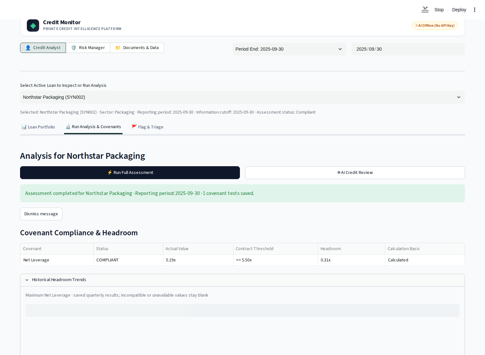

# AI Credit Monitoring

Private-credit teams need to understand whether each borrower can continue to
service its debt, meet its loan obligations, and withstand deteriorating financial
conditions. Checking the financial conditions in a loan agreement, known as
**covenants**, is one part of that responsibility. For every borrower and reporting
period, analysts must piece together financial statements, borrower reports, loan
agreements, amendments, and prior reviews to form a current view of credit risk.
The problem is that evidence is scattered and each agreement can define its own
calculations, limits, and exceptions. Repeating this work across a portfolio makes
it difficult to keep reviews timely, spot emerging risks, and give managers a
consistent, traceable basis for action.

**The calculations are the starting point for credit judgment.** An analyst must
interpret what the results mean for each borrower: why headroom is changing,
whether apparent improvements are sustainable, which risks or mitigating factors
matter, and what evidence is still missing. A borrower can remain compliant while
its financial cushion deteriorates. This analysis drives borrower-specific action
items, such as requesting more information, increasing monitoring, or escalating
a concern to the risk manager, with a clear rationale for each proposed action.

A recurring borrower review requires the analyst to:

1. **Gather the evidence:** collect financial statements, compliance certificates,
   supporting schedules, and relevant business or public information for the period.
2. **Establish the applicable terms:** read the agreement and account for amendments,
   waivers, reporting obligations, covenant definitions, limits, and testing dates.
3. **Reconcile the inputs:** check debt, cash, earnings, interest, and contractual
   adjustments against their sources; resolve missing or conflicting figures.
4. **Calculate compliance and headroom:** apply the contractual formulas, determine
   which tests are active, and measure the remaining room before a breach.
5. **Interpret the results and assess the wider credit picture:** explain trends
   in performance, liquidity, and headroom; weigh signs of resilience against
   downside risks, test assumptions, and identify what could change the conclusion.
6. **Turn the analysis into action:** investigate breaches, waived failures, and
   evidence gaps; recommend borrower-specific follow-up and explain how the
   evidence, risks, and uncertainties justify each action, even where tests pass.
7. **Submit and maintain the review:** present supporting evidence to the risk
   manager, answer challenges, track outstanding actions, and contribute to
   portfolio and credit-committee reporting before repeating the cycle.

The long-term vision is a continuous credit-monitoring platform that brings legal
terms, private financials, public information, portfolio history, and analyst
feedback into a connected workflow. For the industry, this could reduce repetitive
document review and reconciliation, help teams identify deterioration earlier,
and let analysts focus more time on judgment and borrower engagement. Consistent
evidence and review records could also make oversight easier as portfolios grow.
These are potential benefits to validate, rather than measured outcomes of this project.

This proof of concept applies the **From RAG to Agents** course to a focused part
of that problem: **covenant assessment and review**. The scope was narrowed from
the broader vision to demonstrate evidence retrieval, deterministic calculations,
an initial analytical review, and a saved analyst-to-manager handoff. The first
version of that analytical step uses **bullish and bearish AI reviews** of the same
saved assessment: one develops the strongest supported case for resilience, while
the other examines deterioration, downside risks, and evidence gaps. A recommendation
agent weighs both perspectives against the original evidence and the analyst's
criteria to produce an explained, advisory action. This connects calculated results
to proposed borrower actions and follow-up questions. These are building blocks for
the longer-term workflow; analysts and managers remain responsible for deciding
which conclusions and actions are justified.

| Reader or user | What to look for |
| --- | --- |
| Credit analyst | Evidence, covenant calculations, headroom trends, bullish/bearish analysis, and proposed actions to review and submit. |
| Risk manager | The analyst's submission, unresolved flags, and a recorded review decision. |
| Board or credit committee | A saved report of exceptions, pending work, and manager recommendations. |
| Project reviewer | Guided notebooks, prompts, tests, saved evaluation answers, and monitoring evidence. |

The POC does not implement the full borrower-review lifecycle or establish better
credit decisions or measured time savings. See the [POC overview](docs/poc-overview.md)
for its capabilities and boundaries.

**Try the app online:** [Open AI Credit Monitoring](https://bramos-capst.streamlit.app/).
Test the app without installing anything locally. Follow the
[Web V2 workflow guide](docs/guides/web-v2-workflow.md) for a guided walkthrough.

## See the case

For fictional borrower **SYN002**, an analyst asks: “Is the borrower still compliant,
and how much room remains before it breaches its leverage limit?”

At 30 September 2025, the prepared inputs give:

```text
Net leverage = (145 debt − 10 eligible cash) / 26 adjusted EBITDA
             = 5.1923x
Limit        = 5.5000x
Headroom     = 0.3077x
Result       = compliant, with less cushion than in the prior quarters
```

The analytical question is what that shrinking cushion means for the borrower
and what action it warrants. The bullish and bearish reviews weigh the supported
case for resilience against the risk of further deterioration, then recommendation
synthesis identifies a proposed action and remaining diligence questions for the
analyst to consider.

The [worked example](docs/worked-example.md) follows this case from inputs through
analyst findings, risk-manager review, and board reporting. It includes an actual
Web V2 answer and screenshots. The no-key answer is a **rule-based fallback**;
[saved live agent answers](data/evaluation/agent_scenarios/results/2026-11-09-baseline/results.csv)
show model behavior separately.



The bundle contains **37 fictional borrowers, 172 quarterly financial records, and
69 public SEC source references**. Fictional borrowers and real issuers are separate.
Public filings support a separate retrieval/extraction demonstration; they do not
automatically supply the fictional borrowers' calculation inputs.

## How the course methods serve the problem

| Method | Task it supports | Inspect it |
| --- | --- | --- |
| RAG and lexical retrieval | Find filing passages and answer with source references. | [RAG notebook](notebooks/02-rag.ipynb), [document processing](docs/guides/document-processing.md) |
| Structured extraction | Save covenant terms, schedules, and reported facts for reuse. | [Extraction prompt](src/credit_monitoring/agents/prompts/extraction.py) |
| Agent tools | Discover sources and periods, read inputs, calculate covenants, and request forecasts. | [Agents notebook](notebooks/03-agents.ipynb), [tool reference](docs/reference/agent-tools.md) |
| Multi-agent review | Weigh bullish and bearish interpretations of the same assessment, then connect the evidence to an advisory action, rationale, and diligence questions. | [Credit-review notebook](notebooks/04-credit-review.ipynb), [agents guide](docs/guides/agents.md) |
| Synthetic ML baseline | Demonstrate a next-quarter covenant-breach forecast alongside current calculations. | [Assessment and ML](docs/guides/covenant-assessment.md#synthetic-ml-baseline) |
| Evaluation and LLM judges | Separate software checks from observed answer quality and judge agreement. | [Evaluation](docs/evaluation/README.md), [results](docs/evaluation/results.md) |
| Monitoring and feedback | Trace work, inspect failures and usage, and rate individual V2 answers. | [Monitoring](docs/guides/monitoring.md) |

Financial calculations run in Python. AI agents interpret results; they do not
replace the calculation service. The [architecture](docs/architecture.md) explains
these boundaries and links to the implementation.

## Try the notebooks

Requires **Python 3.14** and **uv**. From the repository root:

```bash
uv sync --group notebooks --group dev --extra ml --locked
uv run --locked --group notebooks --extra ml jupyter lab notebooks/
```

Choose the project's `.venv` kernel and run cells in order:

| Notebook | What it demonstrates | External requirements |
| --- | --- | --- |
| [01 — Setup](notebooks/01-setup.ipynb) | Environment and model connection | API key for the greeting |
| [02 — RAG](notebooks/02-rag.ipynb) | Filing retrieval, cited answers, and document extraction | API key for generation/extraction; SEC identity for uncached downloads |
| [03 — Agents](notebooks/03-agents.ipynb) | Tool calls, scope, assessments, forecasts, and follow-ups | API key for agent answers; source preparation for document questions |
| [04 — Credit review](notebooks/04-credit-review.ipynb) | Calculation, bullish/bearish reviews, and recommendation | Sections 1–4 work without keys; section 5 onward makes model calls |

Model calls incur provider usage. To review without spending money, read the
[worked example](docs/worked-example.md), [saved evaluation results](docs/evaluation/results.md),
or run Notebook 04 through section 4. Full prerequisites are in the
[setup guide](docs/guides/setup.md).

## Run Web V2

```bash
uv sync --group dev --extra ml --locked
make preview-v2
```

Open the printed URL. Select **Credit Analyst**, reporting period **2025-09-30**,
information cutoff **2025-09-30**, and **SYN002**. Open **Run Analysis & Covenants**
and choose **Run Full Assessment**. Calculations and the bundled synthetic-trained
model work without keys, downloads, or training.

For Docker, run `docker compose up --build` and open
[localhost:8501](http://localhost:8501). Both launch Web V2. Follow the
[workflow guide](docs/guides/web-v2-workflow.md) for flags, submissions, manager
review, documents, and board reports.

Optional services use the root `.env`; copy [.env.example](.env.example) and set
only what you need: `OPENAI_API_KEY` for generative AI, `SEC_USER_AGENT` for SEC
downloads, and `LOGFIRE_TOKEN` for telemetry. `LLM_MODEL` overrides the default
`openai-responses:gpt-4o-mini`. See [setup](docs/guides/setup.md) for storage and configuration.

## Evaluation results and checks

These are historical observations from different experiments, not comparable
before-and-after scores or current accuracy estimates.

| Experiment | Recorded result | Interpretation |
| --- | --- | --- |
| 60-case baseline, 9 Nov 2026 | 9 automatic passes, 50 failures, 1 execution error | Diagnostic checks plus an uncalibrated model judge |
| 10-case smoke, 9 Nov 2026 | 10/10 deterministic passes | Semantic grading unavailable; not 100% answer accuracy |
| 42-case SEC snapshot, 18 Oct 2026 | 37 failing comparisons, 5 supported-fact matches | Extraction, source coverage, and matching limitations remain open |
| 50-case exercise, 9–10 Nov 2026 | 35/50 heuristic passes; judge agreed on 27/50 | Agreement with automated labels, not human-verified accuracy |

Read [results and representative failures](docs/evaluation/results.md) before
interpreting these numbers. Synthetic ML has no demonstrated real-world forecasting
performance. Citation formatting and structured validation do not establish the
truth of every generated statement.

```bash
make test-all   # Offline app, notebook, and homework checks; live cases skip
make lint
```

[CI](.github/workflows/ci.yml) runs locked offline checks without API keys, with a
separate Python 3.13 job for optional Evidently judges. [Monitoring instructions](docs/guides/monitoring.md)
cover the [Credit Monitor dashboard](docs/guides/monitoring.md#credit-monitor-dashboard),
traces, and V2 feedback. [Hosted Logfire screenshots](docs/assets/README.md#hosted-logfire-screenshots)
and a [local trace capture](docs/assets/README.md#monitoring-evidence) are available
without hosted-project access.

## Repository map

| Location | Contents |
| --- | --- |
| [src/credit_monitoring](src/credit_monitoring/) | Services, agents, prompts, calculations, storage, and Web V2 |
| [notebooks](notebooks/) | Guided demonstrations |
| [tests](tests/), [scripts](scripts/) | Automated checks and command-line tools |
| [data](data/README.md) | Bundled inputs, evaluation evidence, training data, and model |
| [docs](docs/README.md) | Current POC documentation |
| [homework](homework/README.md) | Course exercises and evaluation tools |

## Self-evaluation

| Criterion | Evidence and remaining gap |
| --- | --- |
| Problem and users | Personas and a worked covenant-review case; business benefit has not been measured. |
| Retrieval and agents | Working notebooks, scoped tools, and inspectable prompts; no measured full-corpus retrieval winner. |
| Testing | Offline checks and CI; passing tests do not establish live answer quality. |
| Evaluation | Saved answers, traces, judges, and failures; independent human calibration and a final held-out evaluation remain open. |
| Monitoring | Instrumentation, V2 feedback, local exported traces, and supplied hosted dashboard/extraction screenshots. |
| Reproducibility | Locked dependencies, bundled data/model, no-key path, and Docker; live work needs credentials. |

This is an evidence-based self-review. The Module 5 project scorer was unavailable
and has not been run. Extraction quality acceptance remains open, and the POC has
no authentication, external notifications, or PDF export.
