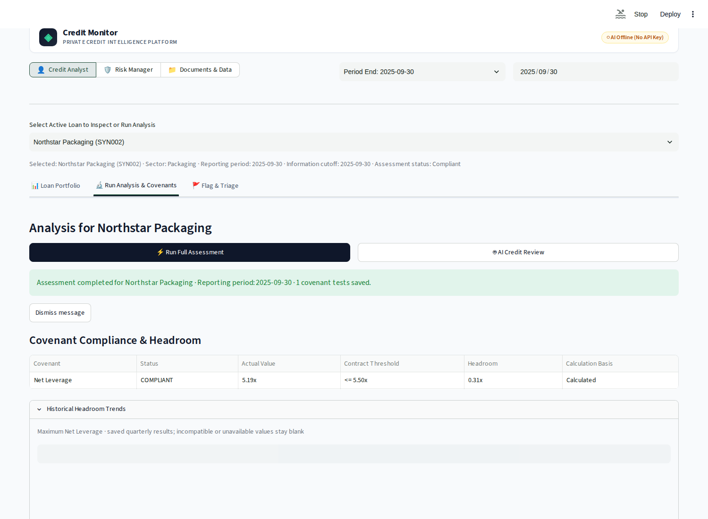

# AI Credit Monitoring

Private-credit analysts check whether borrowers meet the financial conditions in
their loan agreements. A review means finding the right terms, checking financial
inputs, calculating ratios, and explaining exceptions to a risk manager. Amendments,
waivers, missing figures, and scattered evidence make this work difficult to verify.

This proof of concept applies the **From RAG to Agents** course to that problem.
It combines evidence retrieval, deterministic calculations, AI interpretations, and
a saved analyst-to-manager handoff. People remain responsible for the conclusions.

| Reader or user | What to look for |
| --- | --- |
| Credit analyst | Evidence, covenant calculations, remaining headroom, and findings to submit. |
| Risk manager | The analyst's submission, unresolved flags, and a recorded review decision. |
| Board or credit committee | A saved report of exceptions, pending work, and manager recommendations. |
| Project reviewer | Guided notebooks, prompts, tests, saved evaluation answers, and monitoring evidence. |

The broader ambition is continuous credit monitoring across legal terms, private
financials, public information, and portfolio history. This POC demonstrates one
part: **covenant assessment and review**. It does not establish better credit decisions
or measured time savings. See the [POC overview](docs/poc-overview.md).

## See the case

For fictional borrower **SYN002**, an analyst asks: “Is the borrower still compliant,
and how much room remains before it breaches its leverage limit?”

At 30 September 2025, the prepared inputs give:

```text
Net leverage = (145 debt − 10 eligible cash) / 26 adjusted EBITDA
             = 5.1923x
Limit        = 5.5000x
Headroom     = 0.3077x
Result       = compliant, with less cushion than in the prior quarters
```

The [worked example](docs/worked-example.md) follows this case from inputs through
analyst findings, risk-manager review, and board reporting. It includes an actual
Web V2 answer and screenshots. The no-key answer is a **rule-based fallback**;
[saved live agent answers](data/evaluation/agent_scenarios/results/2026-11-09-baseline/results.csv)
show model behavior separately.



The bundle contains **37 fictional borrowers, 172 quarterly financial records, and
69 public SEC source references**. Fictional borrowers and real issuers are separate.
Public filings support a separate retrieval/extraction demonstration; they do not
automatically supply the fictional borrowers' calculation inputs.

## How the course methods serve the problem

| Method | Task it supports | Inspect it |
| --- | --- | --- |
| RAG and lexical retrieval | Find filing passages and answer with source references. | [RAG notebook](notebooks/02-rag.ipynb), [document processing](docs/guides/document-processing.md) |
| Structured extraction | Save covenant terms, schedules, and reported facts for reuse. | [Extraction prompt](src/credit_monitoring/agents/prompts/extraction.py) |
| Agent tools | Discover sources and periods, read inputs, calculate covenants, and request forecasts. | [Agents notebook](notebooks/03-agents.ipynb), [tool reference](docs/reference/agent-tools.md) |
| Multi-agent review | Compare favorable and cautious interpretations of the same assessment, then synthesize a recommendation. | [Credit-review notebook](notebooks/04-credit-review.ipynb), [agents guide](docs/guides/agents.md) |
| Synthetic ML baseline | Demonstrate a next-quarter covenant-breach forecast alongside current calculations. | [Assessment and ML](docs/guides/covenant-assessment.md#synthetic-ml-baseline) |
| Evaluation and LLM judges | Separate software checks from observed answer quality and judge agreement. | [Evaluation](docs/evaluation/README.md), [results](docs/evaluation/results.md) |
| Monitoring and feedback | Trace work, inspect failures and usage, and rate individual V2 answers. | [Monitoring](docs/guides/monitoring.md) |

Financial calculations run in Python. AI agents interpret results; they do not
replace the calculation service. The [architecture](docs/architecture.md) explains
these boundaries and links to the implementation.

## Try the notebooks

Requires **Python 3.14** and **uv**. From the repository root:

```bash
uv sync --group notebooks --group dev --extra ml --locked
uv run --locked --group notebooks --extra ml jupyter lab notebooks/
```

Choose the project's `.venv` kernel and run cells in order:

| Notebook | What it demonstrates | External requirements |
| --- | --- | --- |
| [01 — Setup](notebooks/01-setup.ipynb) | Environment and model connection | API key for the greeting |
| [02 — RAG](notebooks/02-rag.ipynb) | Filing retrieval, cited answers, and document extraction | API key for generation/extraction; SEC identity for uncached downloads |
| [03 — Agents](notebooks/03-agents.ipynb) | Tool calls, scope, assessments, forecasts, and follow-ups | API key for agent answers; source preparation for document questions |
| [04 — Credit review](notebooks/04-credit-review.ipynb) | Calculation, bullish/bearish reviews, and recommendation | Sections 1–4 work without keys; section 5 onward makes model calls |

Model calls incur provider usage. To review without spending money, read the
[worked example](docs/worked-example.md), [saved evaluation results](docs/evaluation/results.md),
or run Notebook 04 through section 4. Full prerequisites are in the
[setup guide](docs/guides/setup.md).

## Run Web V2

```bash
uv sync --group dev --extra ml --locked
make preview-v2
```

Open the printed URL. Select **Credit Analyst**, reporting period **2025-09-30**,
information cutoff **2025-09-30**, and **SYN002**. Open **Run Analysis & Covenants**
and choose **Run Full Assessment**. Calculations and the bundled synthetic-trained
model work without keys, downloads, or training.

For Docker, run `docker compose up --build` and open
[localhost:8501](http://localhost:8501). Both launch Web V2. Follow the
[workflow guide](docs/guides/web-v2-workflow.md) for flags, submissions, manager
review, documents, and board reports.

Optional services use the root `.env`; copy [.env.example](.env.example) and set
only what you need: `OPENAI_API_KEY` for generative AI, `SEC_USER_AGENT` for SEC
downloads, and `LOGFIRE_TOKEN` for telemetry. `LLM_MODEL` overrides the default
`openai-responses:gpt-4o-mini`. See [setup](docs/guides/setup.md) for storage and configuration.

## Evaluation results and checks

These are historical observations from different experiments, not comparable
before-and-after scores or current accuracy estimates.

| Experiment | Recorded result | Interpretation |
| --- | --- | --- |
| 60-case baseline, 9 Nov 2026 | 9 automatic passes, 50 failures, 1 execution error | Diagnostic checks plus an uncalibrated model judge |
| 10-case smoke, 9 Nov 2026 | 10/10 deterministic passes | Semantic grading unavailable; not 100% answer accuracy |
| 42-case SEC snapshot, 18 Oct 2026 | 37 failing comparisons, 5 supported-fact matches | Extraction, source coverage, and matching limitations remain open |
| 50-case exercise, 9–10 Nov 2026 | 35/50 heuristic passes; judge agreed on 27/50 | Agreement with automated labels, not human-verified accuracy |

Read [results and representative failures](docs/evaluation/results.md) before
interpreting these numbers. Synthetic ML has no demonstrated real-world forecasting
performance. Citation formatting and structured validation do not establish the
truth of every generated statement.

```bash
make test-all   # Offline app, notebook, and homework checks; live cases skip
make lint
```

[CI](.github/workflows/ci.yml) runs locked offline checks without API keys, with a
separate Python 3.13 job for optional Evidently judges. [Monitoring instructions](docs/guides/monitoring.md)
cover traces, dashboard navigation, and V2 feedback. A [local trace capture](docs/assets/README.md#monitoring-evidence)
is available without hosted-project access.

## Repository map

| Location | Contents |
| --- | --- |
| [src/credit_monitoring](src/credit_monitoring/) | Services, agents, prompts, calculations, storage, and Web V2 |
| [notebooks](notebooks/) | Guided demonstrations |
| [tests](tests/), [scripts](scripts/) | Automated checks and command-line tools |
| [data](data/README.md) | Bundled inputs, evaluation evidence, training data, and model |
| [docs](docs/README.md) | Current POC documentation |
| [homework](homework/README.md) | Course exercises and evaluation tools |
| [v2-plan](v2-plan/README.md) | Historical records and future proposals |

## Self-evaluation

| Criterion | Evidence and remaining gap |
| --- | --- |
| Problem and users | Personas and a worked covenant-review case; business benefit has not been measured. |
| Retrieval and agents | Working notebooks, scoped tools, and inspectable prompts; no measured full-corpus retrieval winner. |
| Testing | Offline checks and CI; passing tests do not establish live answer quality. |
| Evaluation | Saved answers, traces, judges, and failures; independent human calibration and a final held-out evaluation remain open. |
| Monitoring | Instrumentation, V2 feedback, and local exported traces; hosted-dashboard inspection is separate. |
| Reproducibility | Locked dependencies, bundled data/model, no-key path, and Docker; live work needs credentials. |

This is an evidence-based self-review. The Module 5 project scorer was unavailable
and has not been run. Extraction quality acceptance remains open, and the POC has
no authentication, external notifications, or PDF export.
