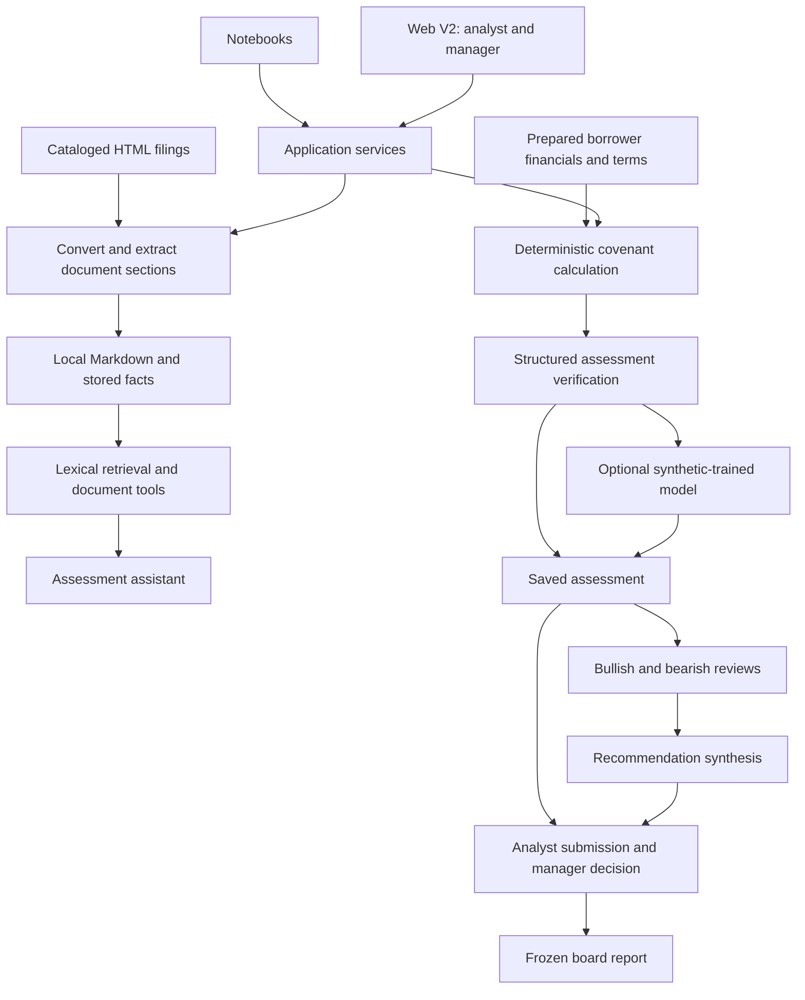

# Architecture

The POC is one Python application with Streamlit Web V2, notebooks, application
services, PydanticAI agents, SQLite, and local files. Entry points compose services
through [bootstrap factories](../src/credit_monitoring/application/bootstrap.py).

## Calculations and evidence

The [assessment service](../src/credit_monitoring/application/assessment_service.py)
resolves period-specific terms, calculates supported formulas, checks structured
results, and builds comparable trends. Missing periods stay missing. Incompatible
economic definitions suppress comparisons. Optional forecasts retain their model
and input identity; model failure does not erase the calculation.

Document processing converts HTML to Markdown, extracts complete structural
sections, and stores results in SQLite. Successful sections can be reused after
failure; complete facts publish only when every section succeeds. Cache identity
includes source hashes, model, prompt, schema, and conversion/segmentation settings.
Search uses MinSearch lexical retrieval over local Markdown. Vector and hybrid
retrieval are not implemented.

These are two explicit evidence paths. Using extracted terms in borrower
calculations requires source bindings and established calculation rules; the
system does not infer a synthetic borrower–issuer relationship. See
[document processing](guides/document-processing.md) and
[assessment methodology](guides/covenant-assessment.md).

## Agents and orchestration

The assessment assistant calls configured services through typed tools. Borrower
selection and issuer scope belong to the application. The three credit-review
roles receive a frozen assessment snapshot: bullish and bearish reviews run
concurrently, then recommendation synthesis sees both full analyses and the original
evidence. They do not independently search or calculate.

Separate roles make arguments inspectable, but do not establish statistical
independence or better decisions than a single reviewer. The [agents guide](guides/agents.md)
explains their contracts and failure behavior. Prompts live in the
[prompt package](../src/credit_monitoring/agents/prompts/README.md).

The assistant returns structured answer fields. The
[backend formatter](../src/credit_monitoring/agents/answer_contract.py) assembles
Markdown for Web V2 and notebooks, including tables and citation labels. Formatting
does not verify that a generated claim is supported.

## Storage and review

Web V2 stores assessments, AI reviews, flags, analyst submissions, manager decisions,
and report versions under `data/runtime/portfolio/`. Submitted cases and finalized
reports retain frozen snapshots. Browser-session chat transcripts are separate from
these durable records; V2 model calls are created per question, with selected saved
analysis supplied as context. See [V2 workflow](guides/web-v2-workflow.md).

SQLite and local files are sufficient for the small, single-process demonstration.
There is no separate API server or database service. Docker volumes preserve runtime
and SEC-cache directories across container replacement. [Data layout](../data/README.md)
distinguishes authored inputs, evaluation snapshots, training data, and local output.

## Verification and monitoring

Structured assessment verification checks calculation replay, identity, provenance,
source availability, and prediction linkage. Automatic post-extraction verification
is disabled (`validation: null`). Neither schema checks nor citation lists prove
the truth of generated prose. V2 submission also automatically records its three
validation checks; this is not proof of independent human verification.

Optional Logfire instrumentation links application work and native model/tool spans
to `session.id`. Independent interactions have separate traces. Tests use scripted
models; [live evaluation](evaluation/README.md) measures a different concern.
See [results](evaluation/results.md) and [monitoring](guides/monitoring.md).
