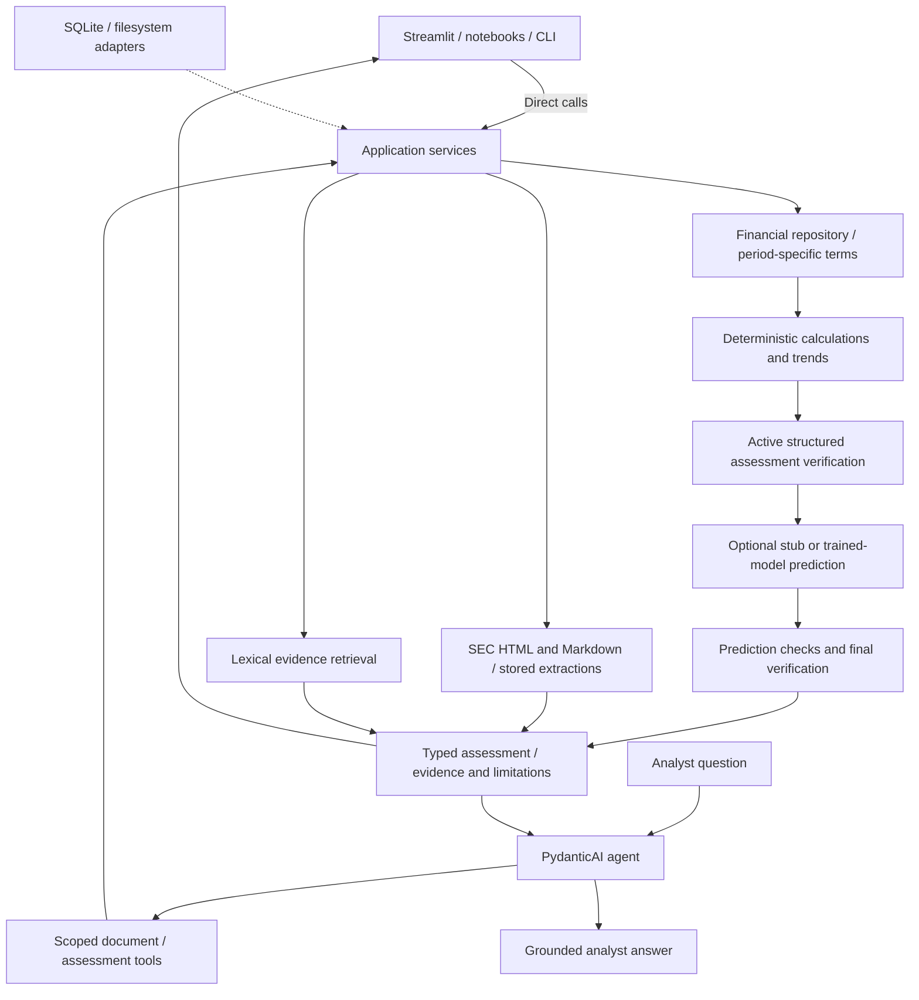

# Architecture

Current implementation reference, updated 18 October 2026. Business scope is in the
[POC definition](poc_definition.md); older execution plans record historical requirements.
PydanticAI is the retained agent framework, including its OpenAI provider integration.

## Working flows

Entry points compose repositories, lexical search, feature builders, models, and narrative
collaborators in `application/bootstrap.py`. Services receive their dependencies; tools wrap
services. Deterministic UI, notebook, and CLI calls do not need an agent. Financial storage
mapping belongs to its adapter, and covenant resolution reads stored facts through an explicit
source interface.

The document workflow downloads into `data/sec_documents/html/<id>.html`, preserves
substantive HTML content, and converts to versioned Markdown. Extraction processes whole
filings in complete structural sections and reuses successful section results after failure.
SQLite identity includes source hashes and conversion, segmentation, prompt, schema, and
model configuration. A complete document is published only after every section succeeds.
The [download CLI](../data/README.md#sec-source-download) shares this cache with processing.

Retrieval is lexical. `LocalEvidenceSearch` owns index reuse and source selection;
vector and hybrid retrieval are deferred. Document tools preserve issuer scope and source
provenance. [Service usage](document_processing.md) covers processing, evidence retrieval,
streaming, tool traces, and scoped conversations.

The assessment workflow resolves explicit covenant inputs for each financial period,
calculates allowlisted formulas, verifies results, and persists them separately from source
financials. It builds comparable deterministic trends even with prediction disabled.
Missing quarters remain missing; incompatible bases suppress comparisons. Optional ML reuses
those features, stores snapshots, and checks prediction identity, probabilities, and provenance.
Final verification runs after predictions are attached.

The stub supplies unknown risk and null probabilities. Retained synthetic generation and
Logistic Regression training use borrower/time-separated validation and shared inference
features. The runtime adapter requires compatible local metadata, versions, and checksums.
See [assessment, training, and data limits](ml_early_warning.md).

## Analyst UI and verification boundaries

Streamlit's working borrower page calls services with bundled synthetic financials and terms.
It displays exact covenant statuses, headroom, trends, sources, verification, and optional
prediction. The separate **Benchmark portfolio (mock)** page displays fixed examples.
Financial inputs and analytics live under ignored `data/processed/streamlit/`. Assessments
and conversations belong to individual browser sessions. Prediction is off by default;
missing chat credentials do not prevent deterministic assessments. SEC borrower/document UI
bindings remain future work.

Automatic post-extraction verification is disabled (`validation: null`); its implementation
and standalone tests remain. Explicitly invalid extraction reports are still rejected.
Structured assessment verification is active and covers calculation replay, identity,
availability, provenance, prediction linkage, and stub honesty. It does not certify the
semantic accuracy of generated prose or live extraction quality.

## Checks and diagnostics

The [README](../README.md#checks) lists the complete offline surface. Core and homework
checks run in Python 3.14; optional Evidently checks run separately in Python 3.13. Live
homework scenarios require explicit flags. Public-cache comparisons have a dedicated
read-only snapshot command and [failure register](public_sec_benchmark_triage.md).

Standard logging provides explicit financial adjustments, selected/rejected terms, abstentions,
and final outcomes. Domain projections run only when INFO is enabled. Scoped identifiers
are isolated between concurrent runs; a small timing context manager reports slow operations
and sanitized failure types. No generic signature-binding decorator or telemetry exporter is used.

## Roadmap

- Add explicit SEC borrower/document bindings to the working UI; do not infer entity relationships.
- Continue Logfire monitoring and fuller live agent/judge evaluation as later learning work.
- Implement [borrower comparison](borrower_comparison_implementation_plan.md) and
  [bullish, bearish, and recommendation agents](bullish_bearish_agents_implementation_plan.md)
  only as their planned requirements are taken up. They are not current capabilities.
- Create a public-news provider or vector/hybrid retrieval package when a concrete
  implementation needs it; empty scaffold packages have been removed.

Financial rules remain deterministic, missing inputs remain missing, synthetic results remain
labeled, and the analyst retains responsibility for interpretation and decisions.
