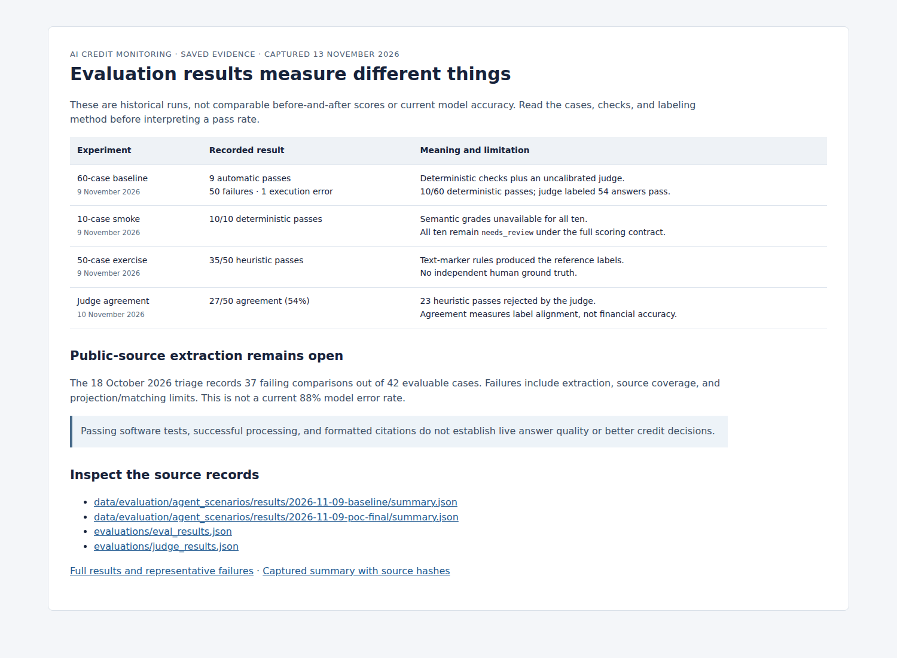
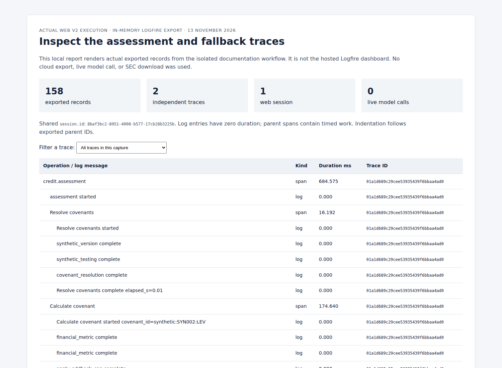

# Demonstration evidence

Captured **13 November 2026** from the actual Web V2 interface using an isolated
copy of the bundled data. The selected case is **SYN002**, reporting period and
information cutoff **2025-09-30**. Analyst/manager names and review notes are
demonstration entries. Existing user workspaces were not used.

## Application captures

| Capture | What it shows |
| --- | --- |
| [Assessment](v2-assessment.png) | A completed covenant assessment: 5.19x leverage, 5.50x limit, 0.31x displayed headroom. |
| [Assistant](v2-assistant.png) | The question and rule-based saved-assessment answer with no API key. [Answer text](v2-fallback-answer.md). |
| [Manager review](v2-manager-review.png) | Submitted observations, Performance flag, and manager recommendation. |
| [Board report](v2-board-report.png) | A finalized report with the saved executive summary and exception register. |

These are browser screenshots, not mockups. They were captured at 1500 × 1100
pixels. Follow the [worked example](../worked-example.md) and
[V2 workflow](../guides/web-v2-workflow.md) to reproduce the content. The offline
fallback reports the current status; it does not provide a generated explanation
of the complete trend. Inspect [saved live answers](../evaluation/results.md#agent-baseline-and-smoke)
for separate model-execution evidence.

No live AI generation, SEC download, or cloud telemetry export was used for these
captures. The assessment uses the included synthetic-trained Logistic Regression
artifact. It does not establish real-world predictive accuracy.

## Evaluation evidence

[Open the local evaluation report](evaluation.html), inspect the
[screenshot](evaluation.png), or read the [captured summary](evaluation-summary.json).
The summary reads the existing 60-case baseline, 10-case smoke, 50-case exercise,
and judge-agreement JSON files and records their SHA-256 hashes. These historical
results were not regenerated or merged into one accuracy score.

## Monitoring evidence

[Open the local trace report](monitoring.html) and use its trace filter, inspect
the [exported record subset](v2-monitoring.json), or view the [screenshot](monitoring.png).

The capture contains **158 actual Logfire records across two traces with one
shared web-session UUID**. It covers the isolated V2 assessment and rule-based
assistant fallback. Timed spans and log events retain their actual identities,
timestamps, and parent relationships. The JSON selects operational fields and
omits full calculation payloads and source paths.

This is an in-memory `TestExporter` capture rendered as a local report, not the
hosted Logfire dashboard. The no-key run has no model requests or provider-token
usage. [Monitoring instructions](../guides/monitoring.md) explain how to inspect
real model/tool activity in an authorized hosted project. Hosted display was not
verified in this capture.

## Verification

- Web V2 integration suite: **34 passed**.
- Notebook checks: **34 passed**.
- Notebook 04 sections 1–4: executed with no credentials and socket connections
  blocked; SYN002 arithmetic and structured verification passed.
- Offline monitoring validator: **1,046 in-memory records**, five questions,
  five turn traces, and one shared web-session UUID. Models were scripted.
- Docker: image built, reached healthy state, and the V2 checker passed. Saved
  assessment persistence was checked after container recreation.
- Lint and documentation links were checked for this revision. These checks do
  not measure live answer quality. No new paid quality run was performed.

[Capture manifest](capture-manifest.json) records the source/input hashes,
configuration, and artifact hashes. The base revision is provenance for the
working branch, not a claim that the documentation changes are committed.
