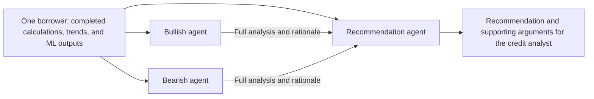

# Credit Perspective Agents — Implementation After Cleanup

Status: implemented at the application-service boundary. See [usage](credit_review.md),
[architecture](architecture.md), and the [decision record](decisions/001-credit-review-agents.md).
The requirements below record the agreed implementation scope; UI integration and live
news collection remain deferred.

## Summary

After the project cleanup is accepted, add three dedicated agents to analyze **one borrower's calculation and ML outputs from two perspectives**:

| Agent | Responsibility |
|---|---|
| **Bullish** | Identify resilience, improving performance, and credible mitigants. |
| **Bearish** | Identify deterioration, downside risks, weak mitigants, and material gaps. |
| **Recommendation** | Weigh both analyses and recommend an action to the credit analyst. |

Both reviewers assess the same borrower, reporting period, information cutoff, and evidence snapshot. A second borrower is not required or selected. Borrower comparison remains a [separate planned feature](borrower_comparison_implementation_plan.md).

**Both reviewers must return evidence-backed reasoning.** The Recommendation agent receives their complete structured analyses, including rationale, assumptions, and counterevidence. These explanations also remain available in the final analyst result.

Deliver application services first, with web UI integration later.

## Prerequisites

Use [the cleanup review](capstone_cleanup_review.md) as the repair roadmap. Start this feature after the repaired baseline is accepted. Revalidate completed fixes rather than reimplementing them:

- Extraction-backed calculations and model prediction work together; retain and revalidate the existing F01 fix.
- Missing and conflicting inputs produce explicit abstention, including SYN010.
- Structured verification has negative regression coverage, and source processing preserves substantive evidence.
- Deterministic trends are available through public assessment results with ML disabled.
- Dependencies are composed at entry points; consumers need no access to storage internals.
- The existing analyst flow uses working services, and documented checks have been rerun.

Confirm the final assessment interface and package layout after cleanup. Do not depend on placeholder packages surviving.

## Implementation sequence

### 1. Define evidence and analysis contracts

Add typed contracts for decision context, shared evidence, perspective assessments, recommendations, review results, and progress events.

Build one frozen evidence snapshot from a completed assessment containing its borrower, dates, sanitized financial inputs, covenant results, deterministic trends, optional ML predictions, verification findings, limitations, and provenance. Consume the public assessment outputs without rebuilding features or rerunning calculations or predictions. Preserve calculation/result identifiers, CSV source rows, document citations, and prediction identities.

Exclude generated narratives, benchmark labels, and source notes. Keep analyst-supplied questions, credit criteria, and constraints separate from financial evidence.

Each perspective assessment must contain:

| Field | Required content |
|---|---|
| Thesis | Overall interpretation from the assigned perspective. |
| Arguments | Individually identified arguments with claims and evidence references. |
| Rationale | Why the cited evidence supports each argument. |
| Credit implications | How each argument affects the assessment of existing exposure. |
| Assumptions | Conditions required for the interpretation to hold. |
| Counterevidence | Facts that weaken or contradict the argument, with an explanation of their significance. |
| Gaps and limitations | Missing information and limits on the conclusions. |
| Change-of-view conditions | Evidence that would materially change the assessment. |
| Confidence | Evidence confidence and its explanation. |

Evidence-based arguments require valid evidence references and a nonblank rationale. Assumptions and hypothetical outcomes must be identified explicitly. An agent finding insufficient support must explain that insufficiency rather than manufacture an argument.

### 2. Implement independent reviewers

Create separate bullish and bearish PydanticAI agents with versioned prompts, injectable models, and typed outputs.

- Give both identical evidence and decision context, with separate histories.
- Run them concurrently; neither sees the other's review beforehand.
- Require each to acknowledge contrary evidence without forcing a favorable or unfavorable conclusion. Empty or weak cases are valid outcomes.
- Preserve supplied values, compliance statuses, prediction identities, and limitations.
- Provide no calculation, retrieval, or execution tools in v1.

Calculations, trends, verification, and predictions remain upstream services. `RiskAnalysisService` retains its narrative responsibility; the existing `CreditAssessmentAgent` retains its question-answer workflow.

### 3. Implement recommendation synthesis

Give the Recommendation agent:

1. The original shared evidence snapshot for the borrower.
2. The complete bullish assessment and its reasoning.
3. The complete bearish assessment and its reasoning.
4. The analyst's decision context.

Pass the structured reviews without an intermediate summarization step that could discard their reasoning.

The recommendation must:

- Identify the strongest arguments from both perspectives.
- Reference argument identifiers and underlying evidence.
- Explain which arguments it accepts, qualifies, or rejects, and why.
- Address disagreements, assumptions, and unresolved uncertainties.
- Explain how those judgments lead to the recommended action.
- State conditions, diligence questions, and evidence confidence.

Do not average opinions or treat agreement as independent confirmation. Use application-controlled execution following PydanticAI's [programmatic hand-off pattern](https://pydantic.dev/docs/ai/guides/multi-agent-applications/#programmatic-agent-hand-off).

### 4. Add the application service

Expose these entry points through `CreditReviewService`, with synchronous wrappers:

- `review_assessment_async(assessment, *, decision_context=None)` reviews an existing assessment without recalculation.
- `review_async(borrower_id, period_end, information_cutoff, *, decision_context=None, ml_enabled=None)` obtains one assessment and delegates to the same workflow.

Return the evidence snapshot, both complete analyses and their reasoning, recommendation, identifiers, completion status, issues, and execution metadata.

Actions are `maintain`, `increase`, `reduce`, `review`, and `defer`. `review` requests analyst reassessment; `defer` indicates insufficient evidence or criteria.

Enforce these boundaries:

- Failed structured verification blocks agent execution and returns `defer`.
- Missing credit criteria require `defer`, while permitting useful analysis.
- Reviewer failure preserves successful work and returns an incomplete review with `defer`.
- Recommendation-agent failure returns a service-generated `defer` alongside completed analyses.
- Missing ML or news remains an explicit limitation rather than automatically blocking review. Stub or unavailable predictions must never become invented forecasts.

Generate provenance and execution identifiers in application code. Validate evidence and argument references. These checks establish traceability; they do not certify every interpretation in generated explanations. Authoritative financial and compliance fields remain in the service-owned result.

### 5. Prepare news and future UI integration

- Add a minimal injectable news provider with an unavailable default; create its package only when implementing this boundary.
- Distinguish unavailable, failed, empty, and available results.
- Require accepted news to retain borrower scope, publisher, URL, publication time, and evidence identifier.
- Exclude future-dated and unknown-publication-time records from point-in-time evidence, disclosing exclusions.
- Add accepted news to the same shared snapshot consumed by both reviewers and the Recommendation agent.
- Return JSON-serializable results and typed progress callbacks.
- Retain both reviewers' explanations and the recommendation's argument-by-argument assessment for future display.
- Use existing logging for model, prompt version, duration, usage, and failure metadata.

## Tests and acceptance

- Confirm one assessment invocation through the convenience API and none when reviewing an existing assessment.
- Verify that a single borrower is sufficient, no second borrower is selected, and all inputs and argument references remain within the configured borrower scope.
- Verify identical evidence, isolated histories, concurrent reviews, and delivery of both complete analyses to synthesis.
- Reject missing rationales and invalid evidence or argument references.
- Confirm final serialization preserves reviewer reasoning and recommendation explanations.
- Cover improving borrowers, deterioration despite compliance, breaches with mitigants, waivers, conflicting inputs, missing history, and absent criteria.
- Test malformed outputs, refusals, timeouts, partial failures, ML limitations, news availability, cutoff filtering, and embedded instructions treated as untrusted evidence.
- Evaluate whether recommendations address the strongest opposing argument and follow from the evidence. Scripted tests establish orchestration; representative opt-in model evaluations assess analysis quality. Do not require disagreement for its own sake.
- Run the cleaned project's existing regression checks.

## Defaults and delivery boundaries

- One borrower per review, with two analytical perspectives; borrower comparison is separate work.
- Existing exposures only; the analyst retains the final decision and no exposure changes are executed.
- Independent reviews followed by synthesis; no rebuttal round.
- Current configured model by default, configurable per role.
- Configurable 60-second timeout per agent and one output-validation retry.
- Confidence means evidence support, not credit risk or probability.
- Deliver services, contracts, tests, and usage documentation.
- Defer web UI integration, review persistence, live news collection, numerical exposure sizing, pricing, new-loan underwriting, and new monitoring infrastructure.
