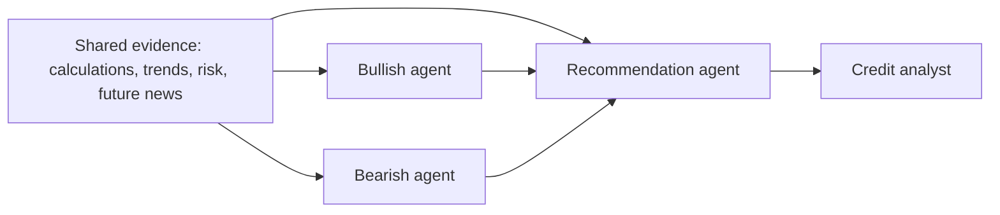

# Bullish, Bearish, and Recommendation Agents

Status: planned; not implemented. Current capabilities are described in [architecture](architecture.md).

## Summary

Add **three dedicated agents**: two independent reviewers and a neutral recommendation agent. Their purpose is to enrich assessment of an existing credit exposure through different interpretations of shared evidence.

Keep `RiskAnalysisService` upstream: it currently provides narrative over structured assessment results, rather than acting as a separate decision agent. Its calculations and optional ML outputs will inform all three agents.

Deliver application services and typed results ready for later web UI integration.

## Agent responsibilities

| Agent | Responsibility | Required output |
|---|---|---|
| Bullish | Identify resilience, improving trends, mitigants, and evidence supporting continued exposure. | Supported arguments, counterevidence, assumptions, gaps, and what would weaken its view. |
| Bearish | Identify deterioration, limited headroom, downside risks, and weaknesses in proposed mitigants. | Supported arguments, counterevidence, assumptions, gaps, and what would weaken its view. |
| Recommendation | Weigh both reviews against the underlying evidence and supplied credit criteria. | Recommended action, rationale, treatment of opposing arguments, conditions, diligence questions, and confidence. |

The reviewers must pursue their assigned perspective without being required to reach a favorable or unfavorable conclusion. Empty or weak cases are valid outcomes.

All agents preserve supplied compliance statuses, calculated values, and prediction limitations. They receive no calculation, retrieval, or execution tools in this first version.

## Implementation changes

### Shared evidence and orchestration

- Add `CreditReviewService`, with synchronous `review(...)` and asynchronous `review_async(...)` methods. Required inputs are `borrower_id`, `period_end`, and `information_cutoff`; optional inputs are analyst decision context and the existing ML override.
- Call `AssessmentService.assess(...)` **once per review**. Build a frozen evidence snapshot containing current and historical results, sanitized financial inputs, deterministic trends, optional predictions, verification findings, and provenance.
- Reuse `RiskFeatureBuilder` for trends when ML is disabled. Missing or incompatible history remains unavailable.
- Exclude generated assessment narratives, benchmark labels, and source notes from the agents' evidence.
- Run bullish and bearish reviews concurrently with separate histories and identical evidence. Pass their validated outputs and the original evidence to the recommendation agent.
- Use application-controlled orchestration and existing PydanticAI dependencies. This follows its documented [programmatic hand-off pattern](https://pydantic.dev/docs/ai/guides/multi-agent-applications/#programmatic-agent-hand-off).

### Public contracts

Add typed contracts for:

- **Decision context:** the analyst's question, supplied credit criteria, and constraints. Treat these as analyst inputs, separately from verified financial evidence.
- **Perspective assessment:** cited arguments, counterevidence, assumptions, limitations, and evidence that would change the view.
- **Credit recommendation:** action, cited rationale, assessment of both perspectives, conditions, outstanding questions, and evidence confidence.
- **Review result:** review and assessment identifiers, evidence snapshot, both perspectives, recommendation, completion status, issues, and per-agent execution metadata.

Recommendation actions are:

- `maintain`: retain current exposure.
- `increase`: support increasing exposure.
- `reduce`: support reducing exposure.
- `review`: recommend analyst reassessment before choosing an exposure change.
- `defer`: insufficient evidence or criteria to support a recommendation.

The recommendation agent must explain which arguments carry more weight and why. It must not average the perspectives or treat agreement as independent confirmation.

### Future public news

- Create an injectable provider at the planned `public_context` boundary when implementing this work (unused placeholder modules were removed); the default reports `unavailable`.
- Distinguish an unavailable feed from an available feed with no relevant results.
- Future records must carry explicit borrower scope, source URL, publisher, publication time, and evidence identifier. Exclude records published after the information cutoff and flag unknown publication times.
- Include accepted records in the shared snapshot so both reviewers see the same news. Implement no live news collection in this release.

### Validation and failure behavior

- Generate provenance and execution identifiers in application code. Validate all agent evidence references against the snapshot.
- Keep authoritative financial and compliance fields in the service-owned result. Generated prose does not replace them, and reference validation does not certify its interpretation.
- If structured assessment verification fails, return a blocked review with `defer` and skip agent execution.
- If a reviewer fails, retain the successful review and return an incomplete result with `defer`. If the recommendation agent fails, return a service-generated `defer` with the completed perspectives.
- Missing credit criteria require `defer`; the result can still provide useful analysis and diligence questions.
- Use versioned prompts, separately injectable models, a configurable 60-second timeout per agent, and one output-validation retry.
- Provide typed stage-progress callbacks and JSON-serializable results for future UI consumption. Record model identity, prompt version, duration, usage, and failures.

## Test plan

- Exercise real assessment services with scripted models: confirm one assessment invocation, identical reviewer evidence, isolated histories, and both reviews reaching the recommendation agent.
- Cover compliant but deteriorating borrowers, breaches with mitigants, waivers, conflicting inputs, insufficient history, and missing decision criteria.
- Verify missing, stub, failed, and synthetic-trained ML outputs retain their limitations.
- Test news unavailable versus empty, future-dated news exclusion, invalid evidence references, malformed outputs, timeouts, and partial failures.
- Confirm results serialize cleanly and existing assessment, chat, calculation, and prediction tests still pass.
- Add evaluation cases assessing evidence support, useful differences between perspectives, and whether synthesis addresses the strongest opposing argument. Do not require disagreement for its own sake.

## Assumptions and delivery

- Existing exposures only; numerical exposure sizing, pricing, and new-loan underwriting are deferred.
- One independent review per perspective, followed by synthesis; no rebuttal round.
- Recommendations support the analyst's decision and trigger no exposure changes.
- Reuse the current configured model by default, with independent configuration available for each role.
- Return review artifacts without adding database persistence in v1.
- Deliver services, contracts, tests, and API usage documentation. Web UI integration remains later work.
