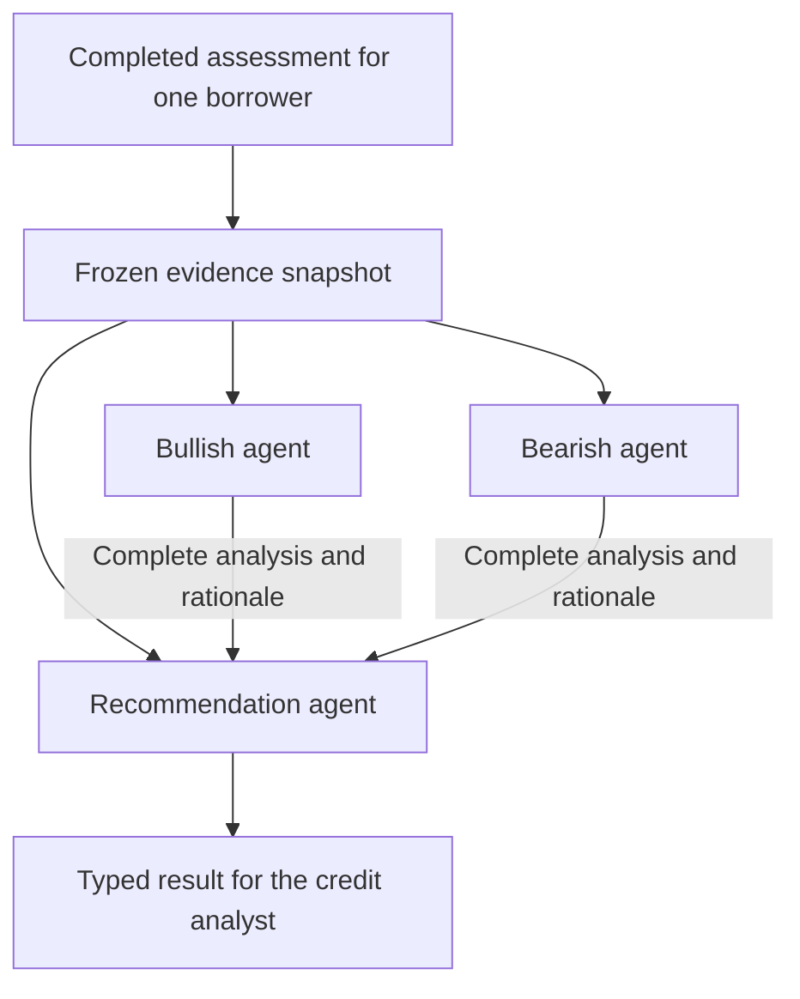

# Credit perspective reviews

The service analyzes one borrower's completed calculations, deterministic trends, and
optional ML outputs from two perspectives. Independent bullish and bearish PydanticAI
agents return evidence-backed analyses. A neutral Recommendation agent receives both
complete analyses and the original evidence, then produces an advisory recommendation.

This workflow is available through Python application services. Streamlit integration,
borrower comparison, live news collection, review persistence, and execution of exposure
changes are separate work. The [architecture decision](decisions/001-credit-review-agents.md)
records the agreed boundaries and implementation choices.



## Review an existing assessment

Given a `RiskAssessment` returned by the existing assessment service:

```python
from credit_monitoring.application.bootstrap import create_credit_review_service
from credit_monitoring.domain.credit_review import ExposureDecisionContext

reviews = create_credit_review_service()
decision = ExposureDecisionContext(
    question="Should the existing exposure be maintained?",
    credit_criteria=(
        "Consider current compliance, comparable headroom trends, and material data gaps.",
    ),
    constraints=("No numerical exposure sizing.",),
)
result = await reviews.review_assessment_async(assessment, decision_context=decision)
print(result.recommendation.model_dump_json(indent=2))
print(result.model_dump_json(indent=2))  # Includes both full analyses and their rationales.
```

Use `reviews.review_assessment(...)` synchronously. Synchronous wrappers reject an
already-running event loop; use `await` in notebooks or async applications.

The default model is the project's existing `DEFAULT_MODEL`. Live calls require its
provider credentials, such as `OPENAI_API_KEY` for the default OpenAI provider. Models
and credentials are resolved at execution time, so constructing the service performs
no model or news calls. This API consumes the completed assessment without calling
calculation, feature-building, or prediction services again.

## Create an assessment and review it

This complete example uses the bundled synthetic inputs and the stub prediction service:

```python
from datetime import date
from pathlib import Path

from credit_monitoring.application.bootstrap import (
    create_assessment_service,
    create_credit_review_service,
)
from credit_monitoring.config.settings import AssessmentSettings
from credit_monitoring.covenants.structured import SyntheticCovenantReader
from credit_monitoring.domain.credit_review import ExposureDecisionContext
from credit_monitoring.financials.repositories import FinancialRepository
from credit_monitoring.ingestion.loaders.financials import load_financials

storage = Path("data/processed/credit_review")
financial_database = storage / "financials.sqlite3"
load_financials(Path("data/synthetic_quarterly_financials.csv"), financial_database)
assessments = create_assessment_service(
    financial_repository=FinancialRepository(financial_database),
    covenant_reader=SyntheticCovenantReader(Path("data/synthetic_covenant_terms.csv")),
    settings=AssessmentSettings(analytics_database=storage / "analytics.sqlite3"),
)
reviews = create_credit_review_service(assessment_service=assessments)
decision = ExposureDecisionContext(
    question="Assess continued exposure to SYN002.",
    credit_criteria=("Review compliance, comparable trends, and unresolved evidence gaps.",),
)
result = reviews.review(
    "SYN002", date(2025, 9, 30), date(2025, 9, 30),
    decision_context=decision, ml_enabled=True,
)
```

`review_async(...)` is the asynchronous equivalent. The convenience path calls
`AssessmentService.assess(...)` once and delegates to the same review workflow. It
passes `ml_enabled` through unchanged. The stub has no forecast or probability; use
the existing [trained-model setup](ml_early_warning.md) for actual synthetic-trained
predictions. Deterministic trends remain available when prediction is disabled.

## Analysis and recommendation contracts

Each perspective returns a thesis and individually identified arguments. An argument
includes its statement, evidence IDs, rationale, credit implication, and assumptions.
The review also retains supported counterevidence, gaps, change-of-view conditions,
and evidence confidence with an explanation. A perspective with no supported arguments
must identify its gaps and use low confidence.

The Recommendation agent receives the original evidence plus both full structured
reviews. No intermediate summarizer discards their reasoning. Its `argument_judgments`
must cover every supplied argument exactly once, using `(perspective, argument_id)`
to identify it. Each judgment explains acceptance, qualification, or rejection and
cites evidence. The final rationale connects these judgments to the recommended action.

| Action | Meaning |
| --- | --- |
| `maintain` | Advise retaining current exposure. |
| `increase` | Advise increasing exposure, without numerical sizing. |
| `reduce` | Advise reducing exposure, without numerical sizing. |
| `review` | Request analyst reassessment before choosing an exposure change. |
| `defer` | Evidence, decision criteria, or completed reviews are insufficient. |

Confidence measures evidence support, not risk or probability. The analyst makes the
final decision. Automated validation checks schema, reference membership, argument
coverage, and permitted actions; it does not establish semantic correctness of prose.

The snapshot stores sanitized assessment data as canonical `assessment_json`, with an
immutable evidence registry and news records. `snapshot.assessment_data` returns an
isolated parsed copy. `snapshot.prompt_context()` returns the JSON-compatible context
used by all agents. Evidence registry paths are JSON pointers into that context.
Calculations retain their result/run IDs, financials retain file/row provenance, and
source citations, hashes, prediction metadata, and availability warnings are preserved.
Generated assessment narratives, raw source-value annotations, benchmark labels, and
CSV/catalog notes are excluded.

## Configuration, progress, and failures

`create_credit_review_service(...)` accepts a shared `model`, per-role `bullish_model`,
`bearish_model`, and `recommendation_model` overrides, `CreditReviewSettings`, an
optional `news_provider`, and an async `event_handler`.

```python
from credit_monitoring.config.settings import CreditReviewSettings

async def progress(event):
    print(event.kind, event.stage, event.error_code)

reviews = create_credit_review_service(
    settings=CreditReviewSettings(timeout_seconds=60, output_retries=1),
    event_handler=progress,
)
```

The timeout covers each role's full run, including output retries. The request limit
is `output_retries + 1`; no function tools or autonomous delegation are registered.
Each role starts with fresh history. A parent cancellation propagates to active model
runs rather than publishing a completed result. A convenience call's upstream synchronous
assessment runs in a worker thread; cancellation does not roll back an assessment
already being persisted by that service.

Callbacks receive immutable `CreditReviewEvent` records for stage start, completion,
failure, and review completion. Concurrent reviewer event order is unspecified.
Callback errors become sanitized issues without discarding analysis. Execution metadata
records application-owned IDs, role, model, prompt version, duration, requests, token
usage, response identity when available, and stable failure codes. Model messages and
provider thinking blocks are not returned or logged.

| Condition | Returned behavior |
| --- | --- |
| Invalid structured verification or mismatched assessment identity | `blocked`, `defer`; all agents skip. |
| Missing credit criteria, no current results, or no supported arguments | Restrict synthesis to `defer`; retain available analyses. |
| One reviewer fails | `incomplete`, `defer`; preserve the successful review and synthesize with low confidence. |
| Both reviewers fail | `incomplete`, service-generated `defer`; skip synthesis. |
| Recommendation agent fails validation, refuses, times out, or errors | `incomplete`, service-generated `defer`; preserve both reviews. |
| Missing or failed news/ML | Disclose the limitation; preserve deterministic evidence and available analyses. |

`complete` describes workflow completion, so a complete review can recommend `defer`.
Consumers should display `result.issues`, snapshot limitations, both analyses, and the
recommendation together. Neither a completed review nor a high confidence explanation
changes underlying compliance or verification status.

## Future public news

Implement `PublicNewsProvider.get_context(borrower_id, information_cutoff)` asynchronously
and return `PublicNewsContext`. Records require a news ID, explicit borrower scope,
title, publisher, HTTP(S) URL, excerpt, and publication time (or explicit `None`).

The default reports `unavailable` and performs no search. Provider failures report
`failed`; an available search with no accepted records reports `empty`. The service
excludes other borrowers' records, unknown publication times, and publication after
the cutoff. A date cutoff includes the complete UTC day. Accepted records join the
same snapshot for all three agents; excerpts remain untrusted evidence. Issuer-to-borrower
mapping belongs to the provider's explicit configuration.

## Validation and model evaluation

Run the offline workflow regressions with:

```bash
uv run --locked pytest tests/integration/workflows/test_credit_review.py
make lint
make test
```

The tests exercise real SQLite assessments and PydanticAI output validation with scripted
model boundaries. They establish data flow, reference validation, rationale retention,
parallelism, failure handling, and serialization. They do not measure live reasoning quality.

For an explicitly requested live evaluation, run representative improving, deteriorating,
breached-with-mitigants, and missing-input cases through the documented service API.
Capture `result.model_dump_json()` with model and prompt metadata. Review whether each
argument is supported, material counterevidence is addressed, the final action follows
from both reviews and supplied criteria, and unavailable predictions or news remain
unavailable. Distinct useful interpretations matter; disagreement alone is not success.
Live calls incur provider usage and require credentials; none run in the portable suite.
