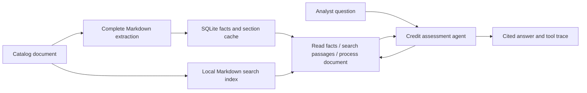

# Complete document processing and the credit assessment agent

The application invokes a synchronous service. It reads complete filing Markdown,
extracts supported facts with the existing LLM, stores them in SQLite, and returns
the result. No queue or worker is needed. Analyst questions can independently use
the RAG agent's tools to read facts and retrieve source passages.



## Invoke from application code

```python
from pathlib import Path
from credit_monitoring.agents.models import DEFAULT_MODEL
from credit_monitoring.application.document_processing_service import DocumentProcessingService
from credit_monitoring.agents.credit_assessment import CreditAssessmentAgent
from credit_monitoring.observability.logging import configure_logging

# Show timestamped progress in the console or notebook cell output.
configure_logging()

service = DocumentProcessingService(
    model=DEFAULT_MODEL,
    source_file=Path("data/public_sec_documents.csv"),
    html_dir=Path("data/sec_documents/html"),
    markdown_dir=Path("data/sec_documents/markdown"),
    database_path=Path("data/processed/covenants.sqlite3"),
    user_agent="Your organization contact@example.com",
)

document = service.process_document("DOC_FMC_AMD3_2025")
facts = document.result.extraction
print(document.cache_hit, facts.model_dump())

# Process every catalog document, reusing complete/current extractions.
outcomes = service.process_all_documents()
failures = [(item.document_id, item.error) for item in outcomes if item.status == "failed"]

# Optional issuer filter or explicit reprocessing.
# outcomes = service.process_all_documents(ticker="FMC")
# outcomes = service.process_all_documents(force=True)

# State inspection and evidence search do not invoke the model or download files.
documents = service.list_document_extractions(ticker="FMC")
passages = service.search_evidence("interest coverage", ticker="FMC")

agent = CreditAssessmentAgent(model=service.model, service=service)
answer = agent.ask("Show FMC's complete covenant schedules with filing evidence.", ticker="FMC")
print(answer.answer)
print(answer.sources)
print(answer.tool_trace)
```

Progress logs show the current document (`document=2/10`) and section
(`section=3/8`), source download/cleanup/conversion, cache reuse, model and input
size, SQLite saves, and a final batch count of completed/failed/cached documents.
Each critical step logs before it starts and reports `elapsed_s` when it completes
or fails. During a model request, the latest `Extract section started` entry
identifies the active request; its duration appears when that request returns.
Failed steps log the exception type; detailed errors remain in returned outcomes.
Document text, prompts, model outputs, and credentials are not included in progress logs.

`configure_logging()` enables INFO console output for `credit_monitoring` only
and can be called repeatedly without duplicate handlers. Applications with existing
logging configuration can instead enable the `credit_monitoring` logger at INFO.
Call `configure_logging("WARNING")` to hide routine progress.

In notebooks or asynchronous application code, use the asynchronous entry point:

```python
answer = await agent.ask_async("Show FMC's covenant schedules with filing evidence.", ticker="FMC")
```

`ask()` raises a usage error when an event loop is already running; use `ask_async()`
in that case. Both consume the same streaming execution path. Supply a provider-qualified
model name or a PydanticAI `Model` instance through `model=`. The default is
`openai-responses:gpt-4o-mini`, using `OPENAI_API_KEY`. Model-specific client configuration
belongs to the injected PydanticAI provider. Synchronous document processing remains
available; agent service tools run blocking operations in worker threads.

`notebooks/02-rag.ipynb` demonstrates narrative RAG and direct document processing.
`notebooks/03-agents.ipynb` is the independent PydanticAI agent walkthrough: model and service
setup, tool inspection, document questions, synthetic financial loading, and borrower
calculations/predictions with answer and trace inspection. Run its cells in order;
it does not depend on state from the RAG notebook. Notebook model cells require API
credentials. Existing direct narrative RAG remains available;
the service's evidence search indexes full local Markdown rather than keyword-selected
excerpts. Search returns up to ten ranked passages, at most two per filing. Complete
schedules should be read from stored extraction results rather than inferred from
those few passages.

## Processing and reuse

- Document IDs resolve through the CSV catalog. New catalog entries appear on the
  next service invocation. Only registered documents can be processed.
- Full Markdown is loaded through the existing download/conversion cache. Downloads
  require an identifying SEC User-Agent; source text is never silently truncated.
- The default extraction text budget is 60,000 characters per request, including
  separate heading context. This is a conservative operational setting, not an exact
  model token limit. Set `max_chars` to change it; API context/output failures remain
  explicit and no partial model output is accepted.
- Larger sources split at paragraph boundaries. Tables retain introducing clauses
  and continuation rows separated by page numbers/rules. An indivisible block larger
  than the budget raises `SectionTooLargeError` before extraction begins.
- Section offsets are measured character offsets in the original Markdown. Heading
  context is supplied as a separate record with its own offsets.
- Complete results and successful sections persist in `document_extractions` and
  `document_extraction_sections`. Transactions finish before model calls begin.
- Cache identity includes source text and metadata, model, schema, prompt, conversion,
  segmentation versions, and text budget. Unchanged documents reuse their result;
  changed inputs are stale until processing succeeds again.
- `process_document(id, force=True)` explicitly discards the matching cached run and
  processes it again. A failed forced run does not expose its previous successful
  result as current. Other historical content/configuration versions remain stored.
- `process_all_documents(ticker=None, force=False)` processes the catalog sequentially
  in CSV order and returns one `DocumentExtraction` per selected document. Individual
  failures return `status="failed"` with an error and do not stop later documents.
  Invalid catalogs raise before any processing. Source-loading errors are reported
  in the returned batch outcomes; extraction failures also retain the existing
  SQLite failure and section-recovery behavior.
- Failed section runs retain successful sections for retry. A complete document is
  published only after all sections succeed. Exact duplicate facts are removed;
  distinct versions are retained without legal reconciliation.
- Read methods return `DocumentExtraction` with explicit missing, stale, unavailable,
  processing, failed, or complete state. Only complete/current results contain facts.

Concurrent processing of the same document is not coordinated in this local POC;
invoke the service serially. Ingestion is systematic and independent of an analyst's
question; the agent chooses tools, not which sections ingestion should read.

## Agent behavior

The loop uses PydanticAI. `CreditAssessmentAgent` builds a scoped `Agent` and drives
`agent.iter()`, streaming model requests and tool-node execution. The four document tools
are `list_documents`, `get_document_extraction`, `search_evidence`, and `process_document`.
An injected `AssessmentService` and explicit `borrower_id` add `get_financials`,
`assess_covenants`, and `predict_risk`.

The model generates only `AnswerContent`: answer, confidence, and confidence explanation.
The application assembles `AgentAnswer` with actual tool sources and traces, completion
status, and errors. Confidence is `low`, `medium`, or `high`, reflecting evidence support;
it is not a calibrated probability, credit-risk prediction, or verification result.
Successful output requires all three generated fields. Failures have null confidence
and explain why confidence is unavailable. Older serialized answers remain readable.

Provider flexibility uses PydanticAI's model interface. Application answers and events
are framework independent; no interchangeable agent-framework abstraction is added.
See [PydanticAI structured streaming](https://ai.pydantic.dev/output/#making-structured-responses-appear-faster).

### Reuse the tool classes

`DocumentTools` and `AssessmentTools` expose explicit methods and a `.tools` property.
The property creates PydanticAI `Tool` objects from bound methods, with strict argument
validation and sequential execution. Signatures and docstrings define their schemas;
services and scope remain on the tool instances and are not model-visible arguments.

```python
from pydantic_ai import Agent
from credit_monitoring.agents.tools.documents import DocumentTools

tools = DocumentTools(service, ticker="FMC").tools
research_agent = Agent(
    model=service.model,
    instructions="Use filing tools to answer questions with exact source citations.",
    tools=tools,
)
result = await research_agent.run("Find FMC's leverage covenant and supporting passages.")
print(result.output)
```

This example shows direct tool reuse. `CreditAssessmentAgent` adds public outcomes,
evidence collection, tool-round budgets and UI events. Adding a tool changes its tool
collection, without changing the streaming runner. Expected service errors are returned
to the model; invalid arguments and unknown tools use PydanticAI's retry feedback and
are normalized in public traces. Unexpected application exceptions propagate.

The default permits six tool rounds and at most seven model requests, including output
validation retries. Several calls in one response count as one tool round. A further
round returns `complete=False`, `error="tool_round_limit"` before its tools execute.
The structured-output tool is excluded from budgets and public traces. Refused, failed,
incomplete and empty responses return explicit failures. Response checks run before
service-tool dispatch. Exhaustive handling retains accompanying service calls when the
model also emits an output in the same response.

Ticker scope is enforced by the tool adapters. The agent cannot force reprocessing;
that remains an explicit application action. The trace records requested arguments
and actual tool outcomes, including errors and cache hits. Private model reasoning
is retained only as needed for model continuation and is excluded from public outcomes.
`sources` lists evidence references actually returned by successful tools; it is not
a semantic verification of every claim in the generated answer.

Tracing is disabled by default. `tracing_enabled=True` enables PydanticAI OpenTelemetry
instrumentation with content capture disabled; exporters are configured by the host
application. Console progress and the public tool trace are independent of tracing.
Single-question methods start fresh; explicit conversations keep history in memory.
No hosted monitoring, persistent chat storage, or live Streamlit integration is added.

### Conversations and follow-up questions

Start an independent conversation to retain prior requests, clarification answers,
tool calls/results, and source citations:

```python
conversation = agent.start_conversation(ticker="FMC")
first = await conversation.ask_async("Find the leverage schedule and supporting passages.")
follow_up = await conversation.ask_async("Which filing supports that threshold?")
print(follow_up.answer)

# All three commands close locally and return None. Case and whitespace are ignored.
assert await conversation.ask_async("done") is None
assert conversation.closed
```

Use `conversation.ask(...)` in synchronous application code. Both methods accept an
optional `event_stream_handler`, just like the agent methods. Ordinary questions
return `AgentAnswer`; only exact `close`, `done`, or `quit` messages return `None`.
Blank questions raise `ValueError` (the notebook input loop ignores blanks).
`conversation.close()` is also available and can be called repeatedly. Closing clears
stored history and source references; further questions raise `RuntimeError`.

Supply `borrower_id="SYN002"` at conversation creation to enable the configured
assessment tools. Issuer and borrower scope cannot change within a conversation.
Start another conversation to change scope. Explicit reporting dates and information
cutoffs from earlier messages can be reused; missing or ambiguous dates still require
clarification. Each conversation accepts one running question at a time.

The application passes PydanticAI `result.all_messages()` history into the next run.
Tool budgets and public traces reset for each question. `sources` also includes
references from earlier successful conversation turns, so an answer using prior
evidence can retain its citations without repeating tool calls. The source list is
available evidence, not a guarantee that every listed source was cited in that answer.
PydanticAI continuation history is private and is not exposed in `AgentAnswer` or progress
events. Incomplete runs preserve prior successful history plus the failed question
and error message, excluding partial tool sequences and new evidence from that run.
You may ask again; previously executed assessment or processing actions are not undone.

In `notebooks/03-agents.ipynb`, set `RUN_DOCUMENT_CHAT` or `RUN_ASSESSMENT_CHAT` to
`True` in its optional conversation cell and run that cell. The shared input loop
displays answers, sources, traces, and live progress until an exit command, EOF, or
keyboard interruption. Both flags default to `False` so Run All does not wait for input.
Each interactive invocation starts fresh; history is not saved across kernel restarts
or automatically summarized.

### View live agent progress and structured answers

`stream_async()` is an async iterator of JSON-serializable `AgentEvent` objects. Events
are `model_start`, `tool_call`, `tool_result`, `answer_update`, and `run_end`. Tool events
retain call IDs. `answer_update.output` is an accumulated, provisional `AnswerContent`
snapshot: replace the displayed value on each update rather than appending it.
Missing confidence fields are normal during generation. Only `run_end.answer` is the
authoritative, validated `AgentAnswer`. Failed runs also finish with a `run_end` event.
Private reasoning and SDK objects are never included in these events.

```python
from contextlib import aclosing

async with aclosing(agent.stream_async("Find FMC's leverage covenant.", ticker="FMC")) as events:
    async for event in events:
        if event.kind == "answer_update":
            render_answer(event.output.answer)  # application-specific rendering
        elif event.kind == "run_end":
            render_final_answer(event.answer)
        else:
            render_progress(event.model_dump(mode="json"))
```

Conversations expose the same streaming method. Use `aclosing` when a consumer may stop
early. Closing or cancelling a stream discards provisional conversation state and closes
model resources; already completed service actions are not undone. Cancellation propagates.

For console progress, pass `event_stream_handler=AgentEventCallback(agent)` to `ask()`,
`ask_async()` or `stream_async()`. A custom callback is `async def handler(event)` and is
awaited before the event is yielded. A per-call handler overrides the constructor default.
Callback exceptions propagate and prevent committing that turn to conversation memory.
The console callback summarizes progress and leaves snapshots for a UI to render.

The agent notebook includes an opt-in `show_stream()` demonstration, including final
confidence. The current Streamlit cockpit remains a mock application.

## Verification and limitations

Automatic post-extraction verification is temporarily disabled for the POC. Imports,
calls, and report-building blocks are commented in `covenants/extraction.py`, with
restoration notes. The verifier implementation and standalone tests remain intact.
Restore those imports/calls and replace `validation=None` with the computed reports
to re-enable it; also update the service configuration version to invalidate cached
unverified results.

Result wrappers use schema version `2.1`; `validation: null` means verification did
not run. Callers must handle null rather than dereferencing `validation.is_valid`.
The LLM's V2 fact schema and required evidence are unchanged. Pydantic parsing and
model error handling remain active. Prompt versions are now extraction/batch `v2.1`;
the old `v2.0` prompt snapshot is retained alongside the new snapshot.

The agent reports source-supported facts and gaps. Calculations and configured-term
applicability are delegated to the assessment service; the agent never infers them
from filing prose. Automatic post-extraction verification and Streamlit integration
remain outside this implementation. Mocked tests establish
pipeline behavior, not live LLM completeness or resistance to injected instructions.

## Calculation and prediction tools

The renamed class lives in `credit_monitoring.agents.credit_assessment`; update
imports formerly using `credit_monitoring.agents.monitoring.MonitoringAgent`.
Document-only construction continues to work. To enable assessments, inject the
existing service; its repositories, covenant reader, calculation rules and model
configuration stay application-owned:

```python
from credit_monitoring.application.assessment_service import AssessmentService
from credit_monitoring.config.settings import AssessmentSettings, RiskModelConfig
from credit_monitoring.covenants.structured import SyntheticCovenantReader
from credit_monitoring.financials.repositories import FinancialRepository

assessment_service = AssessmentService(
    financial_repository=FinancialRepository(Path("data/processed/financials.sqlite3")),
    covenant_reader=SyntheticCovenantReader(Path("data/synthetic_covenant_terms.csv")),
    settings=AssessmentSettings(
        analytics_database=Path("data/processed/agent_analytics.sqlite3"),
        risk_model=RiskModelConfig(type="stub"),
    ),
)
agent = CreditAssessmentAgent(
    model=service.model, service=service, assessment_service=assessment_service,
)
answer = agent.ask(
    "Assess covenant compliance and headroom for 2025-09-30, using an information "
    "cutoff of 2025-09-30. Also request a next-quarter breach prediction and explain "
    "whether the configured model supplies one.",
    borrower_id="SYN002",
)
```

Load the financial CSV first as described in the README. For a trained forecast,
replace the stub configuration with the explicitly selected Logistic Regression
artifact described in [ML usage](ml_early_warning.md#use-the-trained-model-in-assessments).
The default stub returns no probability. Trained baseline results describe a model
trained on simulated histories.

All three tools accept only ISO `period_end` and `information_cutoff` dates. Borrower
scope comes from `ask(..., borrower_id=...)`, not model arguments. If a question also
supplies `ticker`, the caller explicitly identifies its relationship to the borrower;
there is no automatic mapping between the synthetic borrowers and real SEC issuers.
For document-backed calculations, configure `ExtractionCovenantReader` with explicit
bindings and established `CalculationRules` as described in [assessment usage](ml_early_warning.md).
Without borrower scope only the document tools are registered. The agent requests
missing dates rather than choosing a reporting period or cutoff itself.

`get_financials` returns sanitized current metrics and bounded history with source
file/row provenance; notes and benchmark labels are excluded. `assess_covenants`
always disables ML. `predict_risk` runs the assessment service with ML enabled,
ensuring predictions refer to verified calculations and a persisted feature snapshot.
Each assessment call creates a new run, including when predictions follow a prior
calculation call. Model failures preserve the calculation results and appear as
explicit ML status and issues. Missing terms, unresolved formulas, waived tests and
missing inputs retain their existing abstention/status behavior.

Tools return Pydantic domain objects directly: `get_financials` returns a
`FinancialReview` containing `FinancialPeriod` objects; calculation and prediction
tools return `RiskAssessment`. Document tools return `DocumentExtraction`, lists of
`DocumentSummary` (without extraction payloads), or lists of `RetrievedRecord`.
PydanticAI serializes these objects for the model. A framework-only `RootModel`
adapter preserves list serialization, including empty `[]` results; public tool
methods and event/trace outcomes retain ordinary typed lists. Application code uses attributes:

```python
from credit_monitoring.domain import FinancialReview, RiskAssessment, ToolFailure

for execution in answer.tool_trace:
    outcome = execution.outcome
    if isinstance(outcome, ToolFailure):
        print(outcome.code, outcome.message)
    elif isinstance(outcome, FinancialReview):
        print(outcome.current, outcome.history, outcome.issues)
    elif isinstance(outcome, RiskAssessment):
        print(outcome.results, outcome.ml_status, outcome.prediction)
    print(execution.sources)
```

The former JSON-string `ok/data/sources` envelope is removed. Recoverable service
errors and invalid/unknown calls appear as `ToolFailure`; document processing and ML
statuses remain fields on their domain results. `tool_result` events and trace entries
carry source references separately in `sources`. Their snapshots are independent of
retained conversation evidence. Use `model_dump(mode="json")` or `model_dump_json()`
only when exporting or displaying serialized data; exported traces contain the direct
domain result in `outcome`. Database formats and synchronous/async APIs are unchanged.

The public `sources` collection retains filing citations, including those returned
by document-backed assessments. Financial CSV provenance, applied term evidence,
calculation IDs, feature snapshots and model metadata are available in `tool_trace`
outcomes and used in the final explanation. Structured assessment verification is
active; automatic document-extraction verification remains disabled. Neither proves
the semantic correctness of arbitrary generated prose. The UI remains a mock.

Before the SDK migration on October 5, 2026, all 29 existing local filings
partitioned losslessly into 107 sections with the default budget.

SDK migration verification on October 5, 2026: all 148 tests passed, Ruff,
formatting, whitespace, and offline lockfile checks passed, and both notebooks
passed JSON/Python syntax inspection. At that revision, the agent tests used the SDK runner with
mocked model responses, including synchronous and asynchronous HTTP clients,
tool ordering, round limits, failure handling, and concurrent read-only issuer scope.
No live model requests were made during implementation or verification.

## PydanticAI migration

Application generation uses `pydantic-ai-slim[openai]`; direct OpenAI clients and the
OpenAI Agents SDK adapter are removed. Extraction and narrative RAG accept `model=`.
Extraction schemas, prompt versions, segmentation and verification settings remain
unchanged. Cache configuration now includes provider/model identity, so existing rows
remain stored but may be stale once after migration. New cache entries still support
persistent reuse and section resume. The isolated offline judge environment is unchanged.

Tests use PydanticAI `FunctionModel` and `TestModel` with real requests disabled. Provider
contract tests use a mocked HTTP transport. These tests establish wiring and behavior,
not live-model answer accuracy or calibrated confidence.

Migration validation: the full offline suite passed 393 tests. The 37 failing local
SEC gold-cache comparisons also failed on the original revision against the same
read-only database, with identical case IDs. No cached extraction facts or gold labels
were changed. Ruff, package build and schema/syntax checks for all notebooks passed.
