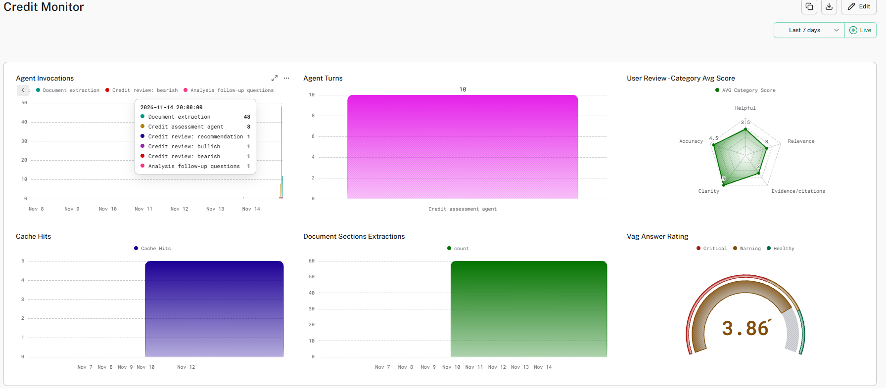

# Monitoring and answer feedback

Monitoring helps the reviewer follow an interaction: what ran, where it failed,
how long it took, and which model/tool calls belong together. The application uses
Logfire's native PydanticAI instrumentation plus application workflow spans and logs.
Telemetry is optional; calculations and saved work do not depend on export.

## Configure

Set the send credential and matching region for your Logfire project in the root
`.env`. For an EU project:

```dotenv
LOGFIRE_TOKEN=
LOGFIRE_BASE_URL=https://logfire-eu.pydantic.dev
LOGFIRE_SERVICE_NAME=credit-monitoring
LOGFIRE_ENVIRONMENT=development
LOGFIRE_SEND_TO_LOGFIRE=if-token-present
LOGFIRE_CAPTURE_CONTENT=false
LOGFIRE_MIN_LEVEL=info
```

Entry points configure monitoring after loading the environment. Imports and
service factories do not initialize it. For Python library use, call
`configure_observability()` from `credit_monitoring.observability` after loading
settings. Exported values take priority over `.env`.

`if-token-present` can use SDK credentials saved locally. Set
`LOGFIRE_SEND_TO_LOGFIRE=false` to explicitly disable export. Application content
capture defaults to false, while `.env.example` sets it true: choose explicitly.
It controls native model content and supported question text. Detailed V2 review
messages are exported even when content capture is false. Keep `.env` and
`.logfire/` out of Git; SDK scrubbing stays enabled.

`LOGFIRE_MIN_LEVEL` controls cloud verbosity. Console logging is configured
separately by `configure_logging()` or CLI `--log-level`.

## Find a V2 interaction in Logfire

1. Open your organization's Logfire project using an account with read access.
   No send credential should be shared with reviewers or pasted into screenshots.
2. Select the time range, service **credit-monitoring**, and configured environment.
3. Run a V2 assessment or assistant question and find its workflow/turn record in
   the project trace view. Copy its `session.id` to find related work.
4. Open the trace and inspect nested calculation/tool/model spans, duration, errors,
   and available native usage. A no-key fallback does not have live model usage.
5. Use **Evals: Live Monitoring**, selecting **Credit assessment agent** or
   **Structured fallback**, to inspect V2 answer feedback separately.

The supplied [hosted dashboard](#credit-monitor-dashboard) and
[document-processing trace](document-processing.md#inspect-the-extraction-trace)
show the Logfire interface. Separate [local monitoring evidence](../assets/README.md#monitoring-evidence)
contains in-memory exported spans with cloud export disabled.

## Credit Monitor dashboard

Open **Dashboards → Credit Monitor** in the Logfire project receiving the
application's telemetry. Select the time range before comparing activity. The
saved [dashboard definition](../../logfire/dashboard.json) contains the panel SQL
and layout, with a seven-day default range and a 60-second refresh interval.



The supplied screenshot shows a seven-day view with **10 assistant turns**,
**5 HTML cache hits**, and a displayed average rating of **3.86**. These are
observations from that capture, not fixed targets or current production totals.

| Panel | What the saved query measures | How to interpret it |
| --- | --- | --- |
| Agent Invocations | Records with `gen_ai.operation.name = 'invoke_agent'`, grouped by agent name in hourly buckets. | Shows activity across document extraction, the assessment assistant, credit-review roles, and analysis follow-up generation. An invocation is not a chat session or a unique user. |
| Agent Turns | Completed `agent.turn` span records, grouped by `agent_name`. | Counts assistant turns, including failed turns; use the trace to inspect the outcome. Several turns can belong to one conversation. |
| User Review - Category Avg Score | Mean numeric `gen_ai.evaluation.score.value` on `gen_ai.evaluation.result` log records, grouped by `category`. | Shows category ratings such as Accuracy, Clarity, and Evidence/citations. The query does not filter by feedback type; quick ratings have no review category. |
| Cache Hits | Log records whose span name begins with `HTML cache hit`, bucketed by date. | Counts reuse of downloaded HTML. This is neither an extraction-cache count nor a cache-hit rate. |
| Document Sections Extractions | Records named `Extract section`, grouped into time buckets. | Shows section-extraction activity rather than distinct documents or successfully completed documents. The query has no record-kind or success filter. |
| Vag Answer Rating | Mean numeric evaluation score across the selected records, displayed on a gauge with a maximum of 5. | The exported title is preserved here. The query includes both 0–1 thumbs ratings and 1–5 detailed-review scores, so its current value is a mixed-scale average. |

For a review-only 1–5 average, restrict evaluation records to
`event_name = 'user.feedback'` and `feedback_type = 'review'` before averaging.
Use `feedback_type = 'quick'` separately for the mean of 0–1 thumbs ratings.
These fields are emitted as attributes. The saved dashboard queries are documented
as supplied; their definition has not been changed.

Use the dashboard to locate activity, then open **Live** to inspect the relevant
trace and its errors, timings, and model/tool calls. Filter by `session.id` for a
browser session or `gen_ai.conversation.id` for a chat. Activity counts and user
ratings do not establish extraction accuracy or independently verified answer quality.

## Sessions and traces

| Identifier | Meaning |
| --- | --- |
| `session.id` | One Streamlit browser session across roles, reruns, borrower changes, and chat clears |
| `gen_ai.conversation.id` | Agent-conversation identity |
| `trace_id` | One chat conversation or independent workflow, including its nested work |

Chat turns share an `agent.session` parent and trace ID. This anchor spans the first
turn; later turns reattach its saved trace context. Its duration is not total chat
duration. Each turn retains its own model/tool spans and interaction ID. Clearing
chat starts a new conversation and trace. No context stays attached between turns.
Other workflows preserve nested parents and propagate to worker threads. New browser
sessions have new UUIDs; this is not persistent cross-tab or cross-process identity. Cached services
do not own browser identity. Filter one web session with:

```sql
SELECT start_timestamp, kind, span_name, trace_id, span_id, attributes
FROM records
WHERE attributes->>'session.id' = '<web-session-uuid>'
ORDER BY start_timestamp;
```

Sum input/output tokens on native model requests, including retries. Do not also
sum agent aggregate usage. Missing usage stays unknown; scripted-model usage is
test data rather than provider billing.

## V2 response feedback

Each analyst/manager assistant response accepts one thumbs rating and one detailed
review. Detailed review needs a 1–5 score and category, with an optional message
up to 2,000 characters. Submission disables that control without rerunning the
answer. The current transcript holds local state; **Clear Chat** removes it.

Feedback emits `gen_ai.evaluation.result` with `event_name = 'user.feedback'`:
`user_helpfulness` scores are 0/1; `user_review_score` scores are 1–5. Saved parent
context links feedback to the original completed response span. Rule-based answers
target **Structured fallback**; errors/status messages are not rateable.

Events include `interaction_id`, `feedback_id`, `session.id`, borrower and
assessment IDs, dates, persona, origin, and model/conversation IDs where available.
Written review messages are included even with `LOGFIRE_CAPTURE_CONTENT=false`.
Export is asynchronous and best effort, without a durable queue or application
retry. The thank-you message acknowledges submission, not confirmed cloud storage.

```sql
SELECT start_timestamp, trace_id, span_id, attributes
FROM records
WHERE attributes->>'event_name' = 'user.feedback'
ORDER BY start_timestamp DESC;
```

## Checks

```bash
uv run --locked python scripts/validate_logfire.py
```

Offline validation uses an in-memory exporter, scripted models, and a network
guard. It checks session/parent relationships, logs, tools, threads, retries,
cancellation, scrubbing, and configuration reuse. It makes no model or SEC calls.

With configured telemetry credentials, `--live` sends synthetic telemetry and
returns IDs for manual dashboard inspection. It does not call a live model or
inspect the hosted UI. Ordinary tests disable export.

The [monitoring exercise](../../homework/monitoring/README.md) has additional
coursework user events and timing fields. Those are separate from V2 feedback.
Custom alerts, durable sessions, and cross-process tracing remain future work.
