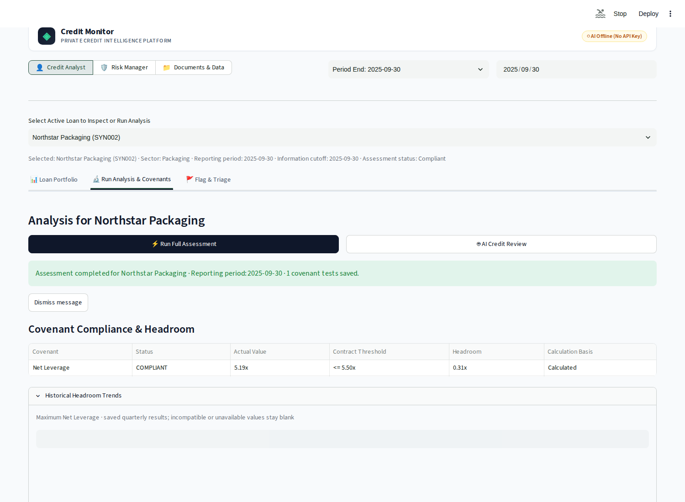
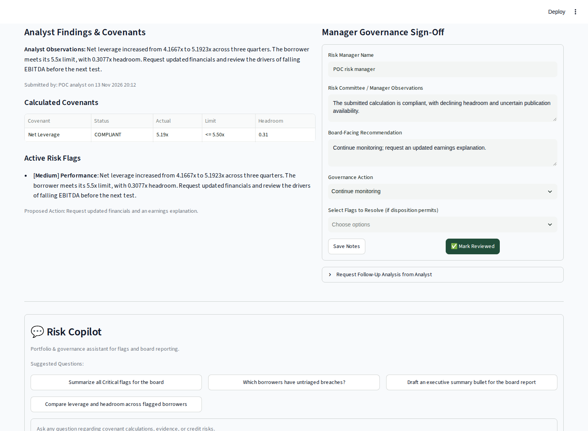
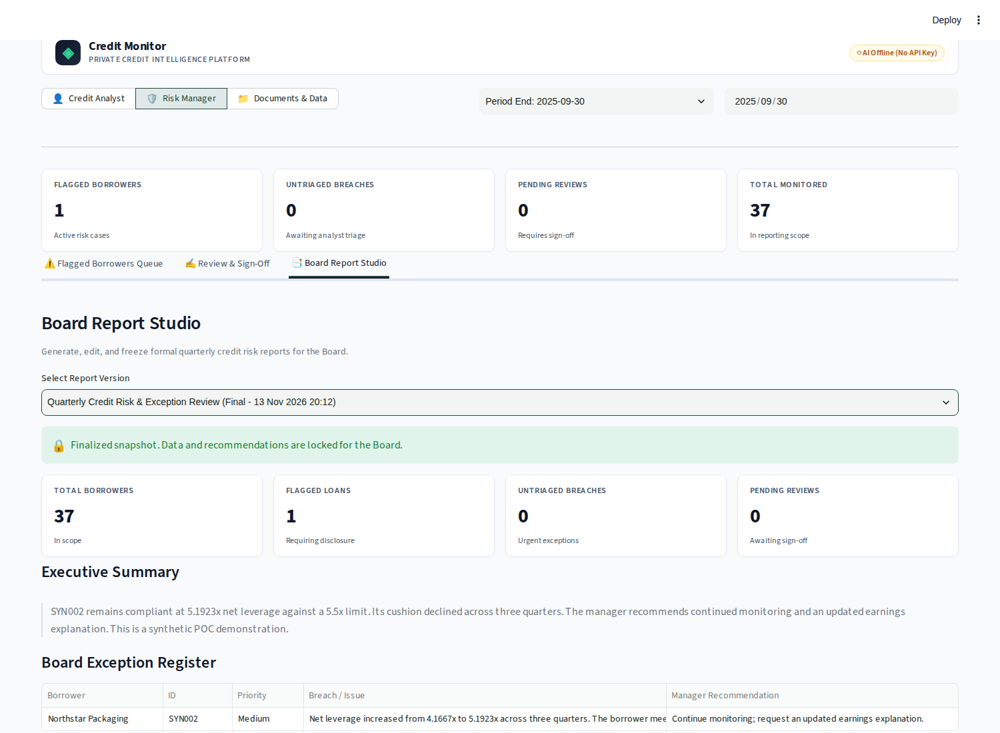

# Review a borrower in Web V2

Start with [setup](setup.md) and `make preview-v2`. The top bar switches between
**Credit Analyst**, **Risk Manager**, and **Documents & Data**. These are views in
one POC, not separate authenticated accounts.

Set **Reporting Period** and **Information Cutoff** explicitly for a repeatable
review. **Latest Eligible Period** can choose different periods for different
borrowers. Use the same dates in both roles when following a handoff.

## Credit Analyst: calculate and investigate

1. Choose **Select Active Loan to Inspect or Run Analysis**. The selected borrower
   controls the assessment and assistant; filtering the portfolio table does not
   change that selection.
2. **Loan Portfolio** shows search, compliance filters, and a primary covenant per
   borrower. Open the analysis to see all covenant results.
3. In **Run Analysis & Covenants**, choose **Run Full Assessment**. This saves a new
   version, calculates covenants, and requests the bundled synthetic-trained
   Logistic Regression forecast. V2 does not expose a prediction-mode selector.
4. Read **Covenant Compliance & Headroom** and **Historical Headroom Trends**.
   Missing inputs, unresolved results, and inactive tests need interpretation;
   an assessment finishing does not mean every covenant is compliant.
5. For an optional model review, choose **AI Credit Review**, enter the review
   question and criteria, then **Submit Review**. Opening the form does not run
   agents. Results appear below the covenant table. Generation requires a key.

Each assessment creates a saved version. Failed model reviews retain the
assessment and earlier available reviews. Calculations and synthetic forecasts
are distinct from generated interpretations.

## Ask the assistant and rate an answer

After an assessment, use **Analyst Assistant**. Selecting a suggested prompt sends
it immediately; the chat input sends a custom question. Without an API key, V2
returns a rule-based summary of the saved assessment. With a key, the assessment
assistant uses saved-analysis tools; recalculation is disabled in this chat.

Transcripts are kept per assessment in browser-session memory. V2 constructs a
fresh model conversation for each question and supplies the saved assessment and
review as context. A visible transcript does not mean previous chat turns are
passed to the model. Changing the selected version changes the chat scope.

Each answer accepts one thumbs rating and one detailed review: choose a score
from 1–5, a category, and an optional message of up to 2,000 characters. **Send
feedback** and **Submit review** save that browser-session state without rerunning
the answer. **Clear Chat** removes it. Export is best effort when Logfire is
configured; the UI does not confirm cloud delivery. See [monitoring](monitoring.md).

## Flag and submit

In **Flag & Triage**, add a category, severity, explanation, and proposed action,
then choose **Add Flag to Borrower**. Add a flag for the SYN002 worked example even
though it is compliant: its narrowing cushion is the reason for manager attention.

Enter **Analyst Name**, **Observations & Summary Recommendation**, and any
**Breach Triage Justification**. **Save Draft Only** saves findings; **Submit to
Risk Manager** freezes the submission's evidence and review context.

V2 automatically records all three validation checks as true during submission,
with a preset verification note. It does not ask the analyst to complete those
checks individually. Inspect inputs and evidence before submitting; the stored
checks are not proof that a person performed an independent verification.
Backend verification and breach-triage rules can still block submission.

## Risk Manager: review and record a decision

1. Switch to **Risk Manager** with matching dates. **Flagged Borrowers Queue**
   lists flagged cases and untriaged breaches. A compliant submission without a
   flag may not appear in this exception-focused queue.
2. Choose **Review** or open **Review & Sign-Off** and select the borrower.
3. Inspect analyst observations, calculated covenants, and active flags. Enter
   manager observations, a board-facing recommendation, and a governance action.
4. **Save Notes** retains a draft decision. **Mark Reviewed** records completion;
   it requires a submission and remains subject to backend completion rules.
5. **Request Follow-Up Analysis from Analyst** records a context-analysis request.
   V2 creates requests but has no dedicated interface for completing and accepting
   their responses. An outstanding request can therefore block sign-off; treat
   this as a demonstrated workflow limit rather than a completed round trip.

The **Risk Copilot** is scoped to the selected saved assessment. Some suggested
prompts mention portfolio comparisons, but its tools do not provide unrestricted
cross-borrower analysis. A suggested prompt is not evidence of that capability.

## Board Report Studio

Under **Risk Manager → Board Report Studio**, choose **Generate Draft from Current
Portfolio**. The report includes exceptions, pending work, and manager decisions.
Edit the executive summary and borrower recommendations, then **Save Draft Updates**.
Use **Refresh Draft Sources** when cases change. Stale sources block finalization.

**Finalize & Snapshot for Board** freezes the version. Select saved versions with
**Select Report Version**. Counts represent borrowers, not portfolio exposure;
borrower debt is not the lender's invested exposure. Reports are displayed in the
app; PDF export is unavailable.

## Documents & Data

Open the role's **Document & Evidence Workspace**. Register cataloged HTML sources
and link them explicitly, fetch missing HTML with `SEC_USER_AGENT`, then process
selected documents with `OPENAI_API_KEY`. Processing defaults to four document
workers, with sequential sections inside each document. Retries reuse completed
sections; force reprocessing reruns them.

Use **Evidence index → Search evidence → Search index** for local passage search.
It searches cataloged local Markdown across borrowers; borrower selection does not
filter it. No key or download is needed for existing text. Results are excerpts,
so inspect stored facts/source text for full schedules.

Extraction supplies evidence without automatically changing financial inputs or
calculation rules. Only HTML is supported. Keep the page open during processing.
See [document processing](document-processing.md) for APIs and cache behavior.
