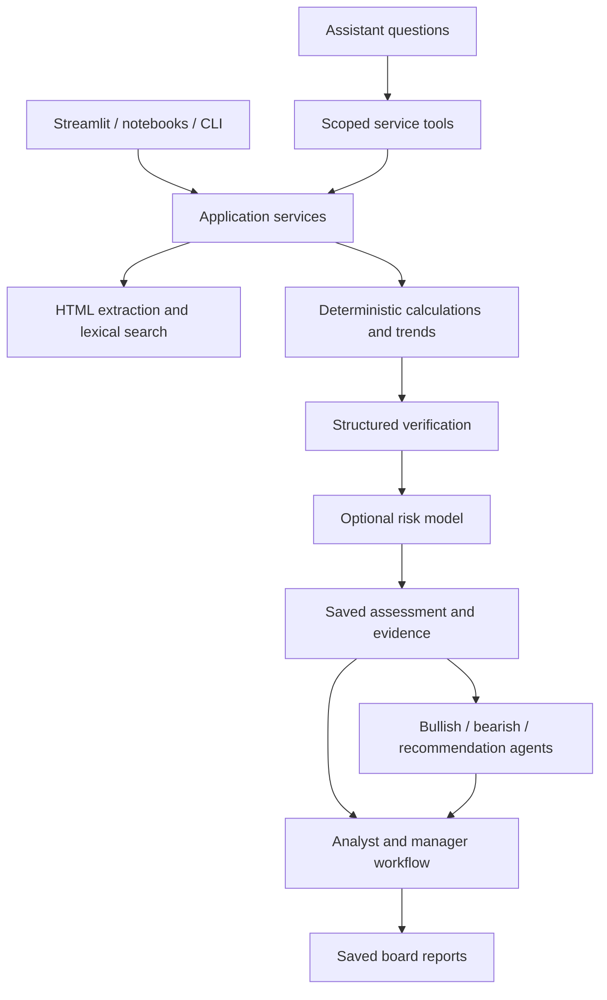

# Architecture

The project uses Streamlit, Python application services, PydanticAI agents, SQLite,
and local files. Entry points compose dependencies in `application/bootstrap.py`.
See [scope](poc_definition.md) and the [workspace walkthrough](../guides/ui_preview.md).

## Assessments and reviews

Assessments resolve period-specific terms, calculate supported formulas, verify results,
and build comparable trends. Optional forecasts use the same calculation inputs and
are checked before final verification. Missing periods remain missing; incompatible
calculation bases suppress comparisons.

The stub returns unknown risk and null probabilities. The bundled Logistic Regression
model uses synthetic training data and compatible local artifacts. See the
[assessment guide](../guides/ml_early_warning.md).

Credit reviews run bullish and bearish agents independently on one saved evidence
snapshot, then pass both full analyses to a recommendation agent. These agents interpret
results without calculation tools. Failed reviews preserve available work and defer
the recommendation. Live news is unavailable. See [credit reviews](../guides/credit_review.md).

## Documents and retrieval

The document service downloads HTML, converts it to Markdown, and extracts complete
structural sections. Successful sections are reused after failure; complete results
publish only when every section succeeds. Cache identity includes source hashes,
model, prompt, schema, conversion, and segmentation settings.

Batch processing defaults to four document workers; sections within a document run
sequentially. SEC downloads retain shared pacing. Search is lexical over local Markdown;
vector and hybrid retrieval are deferred. Source-to-borrower links are explicit.
See [document processing](../guides/document_processing.md).

## Assistant answer rendering

The assistant returns structured answer fields with Markdown in narrative text.
`agents/answer_contract.py` assembles the display `answer` in the backend, rendering
tables and citations consistently for previews and final answers. Streamlit and
notebooks render that string directly with their normal Markdown components.
Confidence stays separately displayed. The formatter handles presentation; it does
not verify generated claims. See the
[Markdown rendering decision](decisions/002-agent-markdown-rendering.md) for the
rationale and the tradeoff with complete model-authored Markdown.

## Workspace and storage

The main workspace (`make preview`) saves assessments, reviews, analyst validation,
flags, submissions, manager decisions, and board report versions under
`data/runtime/portfolio/`. Documents & data manages the working catalog, links,
extraction, and backed-up rebuilds. Submitted and finalized snapshots retain their
original evidence and decisions.

The original single-borrower app (`make run`) uses `data/runtime/streamlit/`.
Its prediction mode starts at Off; the main workspace starts at Logistic Regression.
Assistant conversations stay in browser-session memory. Runtime files and caches are
ignored by Git; see [data layout](../../data/README.md).

## Verification and limits

Structured assessment verification checks calculation replay, identity, provenance,
source availability, and prediction linkage. Automatic post-extraction verification
is disabled (`validation: null`). Neither structured validation nor source references
prove generated prose correct. Public extraction has
[recorded quality gaps](../reviews/public_sec_benchmark_triage.md).

[Offline checks](../../README.md#check-the-project) cover app and homework behavior.
Live quality evaluation is separate. [Logfire](../guides/logfire_setup.md) provides
optional traces and usage; the [monitoring exercise](../../homework/monitoring/README.md)
adds user-action events.

## Future work

- [Borrower comparison](borrower_comparison_implementation_plan.md).
- Live news and private-data integrations.
- Broader live agent and judge evaluation.
- [Simplification proposals](deferred-simplification-plan.md) and vector/hybrid retrieval.
