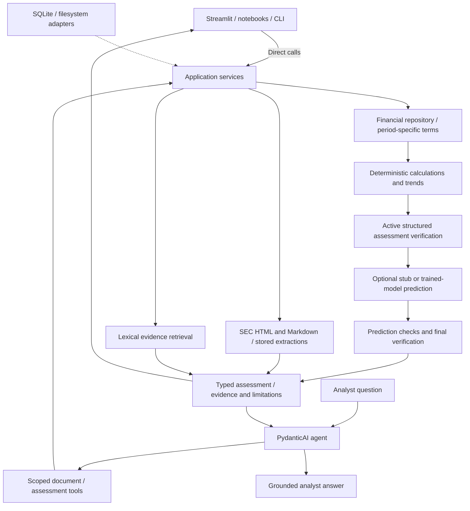

# Architecture

Current implementation reference, updated 27 October 2026. Business scope is in the
[POC definition](poc_definition.md); older execution plans record historical requirements.
PydanticAI is the retained agent framework, including its OpenAI provider integration.

## Working flows

Entry points compose repositories, lexical search, and assessment/review services in
`application/bootstrap.py`. Risk features are built directly from the in-memory run;
model selection uses `create_risk_model(config)` and tests can inject `risk_model`.
Assessment summaries use a plain deterministic formatter. Tools wrap services.
Deterministic UI, notebook, and CLI calls do not need an agent. Financial storage
mapping belongs to its adapter, and covenant resolution reads stored facts through an explicit
source interface.

The document workflow downloads into `data/cache/sec/html/<id>.html`, preserves
substantive HTML content, and converts to versioned Markdown. Extraction processes whole
filings in complete structural sections and reuses successful section results after failure.
SQLite identity includes source hashes and conversion, segmentation, prompt, schema, and
model configuration. A complete document is published only after every section succeeds.
The [download CLI](../../data/README.md#sec-source-download) shares this cache with processing.

Retrieval is lexical. `LocalEvidenceSearch` owns index reuse and source selection;
vector and hybrid retrieval are deferred. Document tools preserve issuer scope and source
provenance. [Service usage](../guides/document_processing.md) covers processing, evidence retrieval,
streaming, tool traces, and scoped conversations.

The assessment workflow resolves explicit covenant inputs for each financial period,
calculates allowlisted formulas, verifies results, and persists them separately from source
financials. It builds comparable deterministic trends even with prediction disabled.
Missing quarters remain missing; incompatible bases suppress comparisons. Optional ML reuses
those features, stores snapshots, and checks prediction identity, probabilities, and provenance.
Final verification runs after predictions are attached.

The stub supplies unknown risk and null probabilities. Retained synthetic generation and
Logistic Regression training use borrower/time-separated validation and shared inference
features. The runtime adapter requires compatible local metadata, versions, and checksums.
See [assessment, training, and data limits](../guides/ml_early_warning.md).

## Analyst UI and verification boundaries

Streamlit's working borrower page calls services with bundled synthetic financials and terms.
It displays exact covenant statuses, headroom, trends, sources, verification, and optional
prediction. The separate **Benchmark portfolio (mock)** page displays fixed examples.
Financial inputs and analytics live under ignored `data/runtime/streamlit/`. Assessments
and conversations belong to individual browser sessions. Prediction is off by default;
missing chat credentials do not prevent deterministic assessments. SEC borrower/document UI
bindings remain future work.

Automatic post-extraction verification is disabled (`validation: null`); its implementation
and standalone tests remain. Explicitly invalid extraction reports are still rejected.
Structured assessment verification is active and covers calculation replay, identity,
availability, provenance, prediction linkage, and stub honesty. It does not certify the
semantic accuracy of generated prose or live extraction quality.

## Credit perspective reviews

`CreditReviewService` provides an application-controlled fan-out/fan-in workflow for
one borrower's completed assessment. Independent bullish and bearish PydanticAI agents
analyze the same immutable evidence snapshot in parallel. A dedicated Recommendation
agent receives both complete structured analyses, including their rationales, assumptions,
and counterevidence, plus the original evidence. It explains how each argument affects
its advisory recommendation. No second borrower is selected.

The review service consumes public calculations, trends, prediction, and verification
outputs without recalculating them. Agents have no function tools. Typed outputs retain
both perspectives and argument-level judgments for future UI use. Invalid verification
blocks execution; failed reviewers force deferral and preserve successful analysis.
An injected news provider defaults to explicit unavailability; no live news search is
implemented. Services expose synchronous/asynchronous methods and typed progress callbacks;
the working Streamlit screen does not yet invoke this review workflow.

See [service usage](../guides/credit_review.md), the [implementation plan](../archive/bullish_bearish_agents_implementation_plan.md),
and [architecture decisions](decisions/001-credit-review-agents.md).

## Checks and diagnostics

The [README](../../README.md#check-the-project) lists the complete offline surface. Core and homework
checks run in Python 3.14; optional Evidently checks run separately in Python 3.13. Live
homework scenarios require explicit flags. Public-cache comparisons have a dedicated
read-only snapshot command and [failure register](../reviews/public_sec_benchmark_triage.md).

Standard logging provides explicit financial adjustments, selected/rejected terms, abstentions,
and final outcomes. Domain projections run only when INFO is enabled. Scoped identifiers
are isolated between concurrent runs; a small timing context manager reports slow operations
and sanitized failure types. Optional shared Logfire integration includes native agent traces,
activity/cost queries, and session context. UI user-action telemetry belongs to the
[monitoring exercise](../../homework/monitoring/README.md); see the [setup guide](../guides/logfire_setup.md).

For the code/data ownership map, see [data navigation](../../data/README.md) and
[homework navigation](../../homework/README.md). The [cleanup review](../reviews/poc_simplification_review.md)
and [deferred simplification plan](deferred-simplification-plan.md) describe complexity tradeoffs.

## Roadmap

- Add explicit SEC borrower/document bindings to the working UI; do not infer entity relationships.
- Continue fuller live agent/judge evaluation; existing Logfire integration and monitoring
  exercises remain optional.
- Implement [borrower comparison](borrower_comparison_implementation_plan.md) when its
  planned requirements are taken up. It remains separate from single-borrower reviews.
- Connect credit perspective reviews to the UI and a live public-news provider when
  requested. Review services and the unavailable-news extension point are implemented.
- Create vector/hybrid retrieval packages when a concrete implementation needs them.

Financial rules remain deterministic, missing inputs remain missing, synthetic results remain
labeled, and the analyst retains responsibility for interpretation and decisions.
