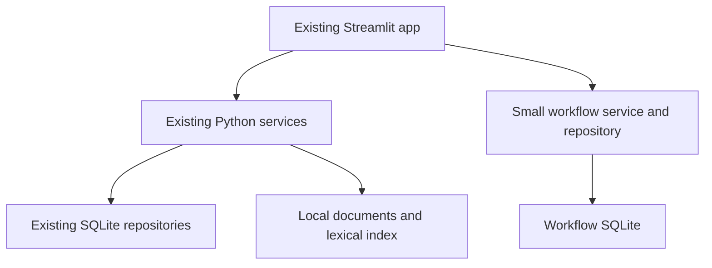

# Final application implementation plan — Streamlit POC

Status: Portfolio connected to calculation services and credit review agents, with
local SQLite snapshots. Other workflows remain a UI preview; their service integration
and persistent workflow storage are planned. See the [POC walkthrough](../guides/ui_preview.md).
Updated: 29 October 2026.

## 1. Goal and approach

Extend the existing Streamlit application to demonstrate the complete workflow:

**Analyst calculates and validates → flags borrower and submits analysis → risk
manager reviews or requests another bull/bear analysis → prepares board report.**

This is a POC. Use one Python application, existing application services, SQLite
and local files. Keep the current `make run` entry point. Analyst and manager
workflows are available directly through page navigation, without login or permission checks.

The `make preview` entry point now combines a connected Portfolio page with sample
screens for the remaining workflows. Portfolio reads actual source dates, saves
complete assessments, and runs bullish/bearish/recommendation reviews on demand.
Those records persist under `data/runtime/portfolio/`. The existing `make run` app
is unchanged. Subsequent steps will connect the borrower, manager and board workflows.

The previous proposal for React, FastAPI, PostgreSQL and a separate worker is
superseded. Build the requested workflows using the current stack and native
Streamlit controls. Heavy operations initially run synchronously with visible
progress; background execution is not a first-release requirement.

## 2. Reuse the existing implementation

| Existing code | Planned use |
| --- | --- |
| `web/app.py`, `web/assessment.py`, `web/style.py` | Extend current navigation, result displays and styling. |
| `web/workspace.py`, `application/bootstrap.py` | Compose the existing services; fix initialization to seed only absent databases. |
| `application/assessment_service.py` | Reuse deterministic calculations, verification, headroom and trends. |
| `application/credit_review_service.py` | Connect bullish, bearish and recommendation outputs to the UI. |
| `agents/conversation.py` | Reuse borrower-scoped chat and conversation memory. |
| `application/document_processing_service.py`, `ingestion/` | Reuse fetch, conversion, extraction, cache and section retry behavior. |
| `retrieval/lexical/local.py` | Reuse lexical retrieval; add explicit clear/rebuild support. |
| Existing financial, extraction and analytics repositories | Keep SQLite and current calculation contracts. |
| `tests/integration/workflows/test_streamlit_app.py` | Extend existing Streamlit AppTest coverage. |

The working portfolio must use saved assessments. Keep the existing fixed benchmark
examples separate. Copy the bundled financial database only when the working copy
is absent; restarting the POC must preserve local changes.

## 3. Screens and behavior

Use the current sidebar navigation to open each page directly. A separate workspace
selector is unnecessary. Optional author names are plain text.

| Page | Purpose |
| --- | --- |
| Borrowers | Searchable list of existing borrowers and latest performance. |
| Borrower analysis | Calculations, evidence, bull/bear output, chat, validation and flags. |
| Documents and data | Fetch/process documents and rebuild indexes or databases. |
| Risk review | Portfolio metrics, flagged borrowers, comments and further-analysis requests. |
| Board report | Prepare, save and display a report covering flagged borrowers. |

### 3.1 Borrower list

Populate from existing borrower metadata rather than completed assessments. Include
borrowers without financials, processed documents or saved results. Keep explicit
borrower-to-document mappings; unmapped catalog issuers stay visible in the document
inventory until linked, without guessing identity from names or tickers.

Use a text search, selectboxes and `st.dataframe`. Show borrower ID/name, sector,
available periods, latest assessment date, compliance, key ratios, document status,
open flags and review status. Filter by sector, period, compliance and flags.
Selecting a borrower opens its analysis page. Missing results say “Not assessed”
or “Data missing.” The POC dataset fits in memory; no separate search service or
server-side pagination is needed.

Offer selected-period and latest-available views. In the latter, show each row's
actual reporting period. Opening the list must not rerun assessments.

### 3.2 Borrower analysis and analyst handoff

Reuse borrower, period, information cutoff and prediction controls. Organize content
with tabs or expanders:

- Overview: results, trends, flags and data gaps.
- Calculations: inputs, formulas, adjustments, thresholds, headroom and verification.
- Credit analysis: bull case, bear case, recommendation, assumptions and evidence.
- Report and review: analyst observations, validation, flags and manager feedback.
- History: prior assessment and review versions.

Provide buttons/forms to:

1. Run and save a complete assessment using the existing service.
2. Run and save the existing bull/bear/recommendation review against that assessment.
3. Validate results, recording observations and unresolved exceptions.
4. Flag a borrower with category, severity, explanation and proposed action.
5. Prepare and submit the analyst report to the manager review list.
6. Recalculate with explicitly revised inputs and a reason, saving a new run.

Verification errors prevent a fully validated submission. Missing data can be
submitted with explicit exceptions. Breaches stay visible before flagging; submitting
a breach requires a flag or an explained triage decision. Submitted reports store
the exact assessment/review IDs and analyst text. Recalculation preserves old runs
and requires fresh validation; it does not silently close flags or replace sign-off.

### 3.3 Chat alongside the analysis

Use a narrow right-hand column with Show/Hide and Expand controls. Expand opens a
wide Streamlit dialog using the same conversation/messages. Keep sidebar navigation
separate from chat. Native columns and a dialog are sufficient; no custom component
or dependency upgrade is required by the installed Streamlit version.

Keep conversation objects and display mode in `st.session_state`. Scope each
conversation to borrower and assessment version. Changing either selects or starts
the matching conversation rather than mixing facts. Chat can reset on browser reload
in this POC; decisions and observations must be saved in SQLite.

Reuse existing tools and citations. Explanation-only questions read saved results
where possible. Recalculation through chat saves a new assessment through the same
save path as the assessment button and updates the displayed version.

### 3.4 Documents and heavy data operations

Show a borrower selector and document table with source URL/type/date, local
availability, extraction state and failures. An analyst can:

- Register a new document URL, metadata and explicit borrower link in a local working
  catalog, leaving bundled fixtures unchanged.
- Fetch selected or missing documents using the existing supported-source loader.
- Process selected or missing/stale documents; explicitly force reprocessing when needed.
- Inspect extracted facts, sources and cache reuse; retry failed documents.
- Rebuild the lexical retrieval index from local document text.
- Recreate a selected financial, extraction or analytics SQLite database.

Start with the existing SEC HTML pipeline and registered URLs. Unsupported formats
remain explicit; additional parsers can follow when needed.

Run heavy operations directly from explicit buttons using `st.status` and
`st.progress`. Show stage, current document, completed/total counts and individual
errors. Add a small progress callback where current services lack one. Process
batches sequentially and reuse existing completed-document/section caches on retry.

The analyst keeps the operation page open until it finishes. Completion after
navigation, disconnect or server restart is not guaranteed. Disable duplicate
launches and use a single process-local lock for overlapping maintenance operations.
Store a simple operation summary; show unfinished records as interrupted on restart,
without automatic job recovery, heartbeats or a queue.

Recreation controls show the target and required sources. Rebuild financials from
known source files, restore extraction records or explicitly rerun extraction, and
restore analytics from retained assessment snapshots or rerun selected assessments.
Create a local backup, build and validate a replacement, then reopen affected
repositories and clear relevant caches. Missing source inputs produce an error.
Keep workflow/report storage separate so rebuilds preserve flags and reports.

For index recreation, clear/rebuild the existing in-memory lexical index and verify
retrieval. No distributed index generations or vector database are required. New
sources mark affected assessments as needing review; saved results and reports stay
unchanged until an explicit reassessment.

### 3.5 Risk manager review

Show portfolio cards for borrower count, assessed/unassessed counts, breaches,
flagged borrowers and pending review. Derive them from the same saved results as
the borrower table, preserving waived, not-tested and incomplete statuses.

List flagged borrowers with severity, analyst explanation, period and review state.
Opening a borrower shows the submitted report, calculations and full bull/bear output.
Place a prominent credit analysis snapshot before the handoff and manager review
form, with separate bullish, bearish and recommendation agent cards listing their
main arguments. Use the same snapshot on the borrower overview and credit analysis tab.
The manager can comment, record a recommendation, mark reviewed or request further
analysis with a question and additional context/data.

- Context-only request: run another bull/bear/recommendation review against the
  saved assessment and new context. Save a new review and keep the prior one visible.
- Corrected financials/terms: return to the analyst for recalculation, validation
  and resubmission.
- Record context source/date where known; unsourced claims stay assumptions. Later
  information requires an updated review cutoff.

Reuse `ExposureDecisionContext` for questions, criteria and constraints. Extend the
review evidence snapshot only as needed for cited additional facts shared with both
perspectives. Keep existing independent bull/bear reviews and recommendation synthesis.
Numeric what-if modeling can follow later.

Initially use count-based portfolio metrics. Show monetary exposure only when actual
portfolio exposure data exists; borrower total debt cannot substitute for it.

### 3.6 Board report web page

The manager selects a period and generates a draft containing every currently flagged
borrower in scope, including unresolved older cases with actual assessment dates.
Show untriaged breaches and pending reviews explicitly.

Render as a Streamlit page containing:

- Portfolio summary, reporting dates and missing-information counts.
- Complete flagged-borrower table with short explanations and review status.
- Per borrower: risk analysis, mitigants, bull/bear conclusions, analyst observations,
  manager recommendation and outstanding actions.

Allow editing of executive summary and recommendations, then save a finalized
report snapshot in SQLite. Missing analysis/recommendations remain labeled pending.
Later assessments do not rewrite the saved report. Provide a report selector and
optionally a `?report_id=...` link to open a saved report directly. No separate
website or PDF generator is needed.

## 4. Minimal architecture and persistence

Keep existing databases and add one `workflow.sqlite3` with a small schema:

| Table | Stored data |
| --- | --- |
| `assessments` | Complete result JSON, borrower/dates/run ID, parent ID and validation/submission text/state. |
| `credit_reviews` | Complete review JSON, assessment ID, added context and previous review reference. |
| `flags` | Borrower/assessment link, severity, explanation, observations and open/resolved state. |
| `review_notes` | Manager comments/recommendations and their assessment/flag references. |
| `analysis_requests` | Question/context, open/completed state and fulfillment assessment/review ID. |
| `board_reports` | Report ID, dates, draft/final content and frozen source snapshots. |
| `document_links` | Explicit borrower-to-catalog-document associations. |
| `operations` | Operation scope, started/completed/failed/interrupted state and outcome summary. |

Serialize nested Pydantic results as JSON rather than normalizing every field.
Use small schema initialization/versioning code following the existing SQLite style;
no ORM or migration framework is necessary. Use transactions for related saves.

Session state holds selections, conversations and unsaved forms. SQLite holds results,
flags, requests, notes and reports so page navigation and app restart preserve
the demo. Do not cache mutable conversation objects globally. Clear only affected
read/service caches after changes.

Keep workflow states simple: draft → submitted → changes requested / reviewed.
Manager disposition never changes deterministic compliance. Organize new rendering
under `web/`, shared workflow actions under `application/` and the small repository
under `persistence/`. Streamlit calls Python services directly.

## 5. Implementation order

| Step | Deliverable | Acceptance check |
| --- | --- | --- |
| 1. Borrowers and saved results | Direct page navigation, complete borrower list, workflow SQLite, complete assessment saves and safe seed initialization. | Analyst and manager views show saved results after restart; unassessed borrowers remain listed. |
| 2. Analyst workflow | Calculations/evidence, bull/bear integration, chat panel/expansion, validation, flags and report submission. | Analyst assesses, checks, discusses and submits a flagged borrower. |
| 3. Document/data controls | Working catalog, fetch/process/reprocess, index/database recreation and progress displays. | Analyst processes a new source and rebuilds selected data while preserving saved workflow/reports. |
| 4. Risk manager workflow | Metrics, flagged list, comments, requests, context rerun and recommendation. | Manager requests another analysis and compares old/new results before recording a recommendation. |
| 5. Board report | Draft editing, flagged register, saved snapshot and report viewer. | Every flagged case has an explanation, risk analysis and recommendation or explicit pending status. |

First milestone: list all borrowers and save a real assessment visible in both
views. Then complete one breach case end to end before adding further polish.

## 6. Verification and scope

Extend existing repository/service tests for persisted assessments, flags, requests
and report snapshots. Extend Streamlit AppTest coverage for listing, submission,
manager review and reporting, using real calculations and mocked LLM responses.
Check that reruns do not repeat heavy operations or overwrite saved inputs.

Exercise database/index rebuilds with temporary data, including failure that leaves
the working database usable. Check report stability after recalculation. Run affected
regressions and the existing lint check.

Manually demonstrate one breach, one compliant borrower and one missing-data case,
including document processing and manager-requested bull/bear review. Verify chat
expansion/collapse keeps the same conversation.

The POC assumes one app process, a small portfolio and light sequential use. It does
not require authentication, an API server, a separate frontend, PostgreSQL, background
workers, restart-proof tasks, distributed locks, object storage, durable chat,
external notifications, automated scheduling or production deployment hardening.
Add infrastructure only when a demonstrated POC need justifies it.

Implementation references: [Streamlit status displays](https://docs.streamlit.io/develop/api-reference/status/st.status),
[dialogs](https://docs.streamlit.io/develop/api-reference/execution-flow/st.dialog)
and [session state](https://docs.streamlit.io/develop/api-reference/caching-and-state/st.session_state).
