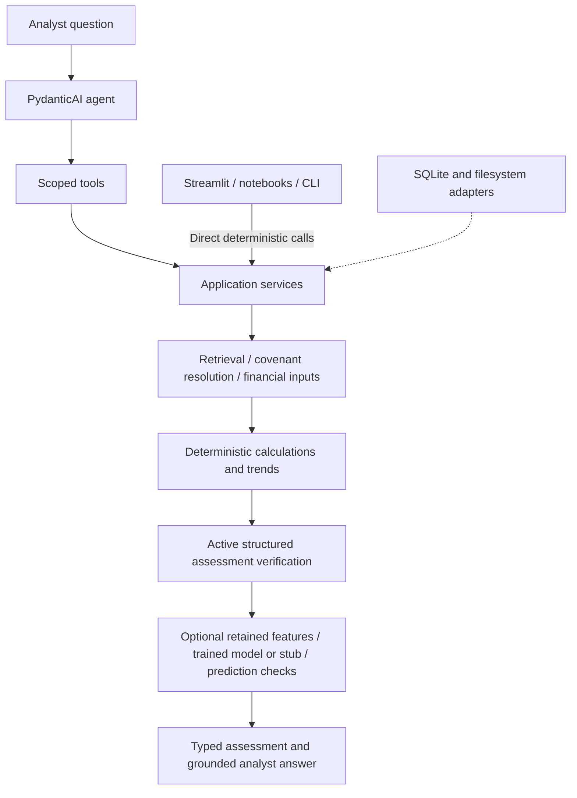

# Capstone cleanup and polish review

> Historical record. Paths, APIs, commands, and line numbers below describe the original work. For the current layout and runnable commands, use the [documentation index](../README.md).

Date: 17 October 2026. Reviewed revision: `3961c81`.

The Architect, Code Reviewer, and Tester agents ran in parallel. This document consolidates their findings, resolves overlapping recommendations, and incorporates the project owner's clarifications. The review is analysis only: no application source, tests, configuration, notebooks, datasets, or model artifacts were changed. This report is the sole intended repository addition.

The project has useful deterministic rules, evidence contracts, and ML safeguards worth preserving. The main cleanup opportunity is to make those capabilities form one understandable capstone workflow. Removing folders alone would leave the more consequential gaps: incompatible covenant classifications between extraction and ML, conflicting benchmark expectations, an unconnected Streamlit demonstration, and incomplete assurance of the final analyst answer.

## Confirmed scope

The owner's answers during this review take precedence over older plans:

- **Use PydanticAI as the primary framework.** The initial direct OpenAI SDK requirement was withdrawn. Keep the OpenAI provider integration through PydanticAI; no direct-SDK rewrite is recommended.
- **Keep synthetic ML training and risk prediction.** They are part of the retained POC and support the owner's risk-agent direction. Do not remove `ml/`, `features/`, their model contracts, or their business tests as speculative scope.
- **Streamlit must use the working services.** A fixed mock is insufficient for the intended submission.
- **SYN010 keeps its missing financial inputs and must abstain from an unsupported compliance conclusion.** Do not backfill inputs from the gold ratio or notes. A covenant that is inactive can still be identified as not tested.
- **Automatic post-extraction verification stays disabled for now.** Preserve its validators and standalone tests. Active structured assessment verification remains a separate requirement.
- RAG, agents, simple assertions, and LLM-as-judge are current learning objectives. Logfire monitoring and fuller agent evaluation come later; this cleanup should not add their infrastructure.
- Future risk agents are a direction, not an instruction to implement more production agents during this analysis.

The business baseline is `docs/poc_definition.md:3`, the nine-step objective in `06_POC_Code_Agent_Implementation_Spec.md:38`, and the later extraction and ML plans, subject to the clarifications above. Older prohibitions on agent frameworks do not override the confirmed PydanticAI direction.

## Coverage and validation

The combined review inventoried 243 tracked files, including all 111 package Python files, seven scripts, six judge implementation files, the SEC download utility, three notebooks, and all 31 test modules with their helpers. The production Python inventory contains 125 files and approximately 8,696 lines. Review covered domain models, ingestion, retrieval, covenant resolution, calculations, application services, agents/tools/conversations, persistence, ML/features, web UI, logging, and judge tooling. Placeholder initializers were distinguished from executable implementations.

No full notebook runs, live agent scenarios, SEC downloads, or credentialed judge calls were executed. Offline notebook tests exercise selected actual code cells with mocked services/models. Static review and scripted model tests cannot establish live extraction accuracy, model decision quality, or judge calibration. Current tests also cannot establish the historical intent of their authors; findings assess the behavior the assertions actually prove.

| Check executed during this review | Result |
| --- | --- |
| `.venv/bin/python -u -m pytest -q -p no:cacheprovider -o faulthandler_timeout=30 --tb=short tests homework-tests` | **441 passed, 37 failed, 6 skipped** in 33.88 seconds. All failures are cached public SEC gold comparisons; all six skipped cases are opt-in live homework scenarios. |
| Offline collection of `tests` and `homework-tests` | 484 cases collected. |
| Isolated Python 3.13 judge suite, using its own configuration | 18 passed; 10 third-party deprecation warnings. Model responses mocked. |
| `.venv/bin/ruff check --no-cache .` | Passed for the root configuration's included paths. |
| Judge source/tests with `tools/llm_judges/pyproject.toml` Ruff configuration | Passed. |
| Explicit Ruff check of `data/download_sec_documents.py` | Two findings: `I001` import ordering and `E401` combined imports. This utility is outside the root lint include list. |
| Typed feature-conversion probe | A valid feature object with `covenant_type="leverage"` raises the unsupported-family error described in F01. |
| Local HTML-cleaning probe | A substantive AVITA financial heading with `shareholders` in its ID is removed, as described in F03. |

The first sandboxed runs stalled in mocked provider tests. A minimal Python `asyncio.to_thread()` example also stalled there. Those runs were interrupted, and the complete offline suite above finished outside the sandbox using the existing approved test command. The sandbox stall is not reported as a project defect. Tests used temporary working databases; Git verification confirmed no tracked inputs or source files changed.

Historical evidence is separate: `homework-tests/README.md:32` records 15 October 2026 runs in which all three ordinary live scenarios and all three judge scenarios failed. Reported problems included missing prerequisite calls and guessed dates. Those live results were not reproduced in this review and should not be presented as current measured results. `docs/llm_judges.md` also records 37 pre-existing public-cache benchmark failures; this review independently observed 37 failures in that same test category.

## Prioritized findings

P1 means a retained POC capability, business expectation, or important assurance gap needs attention. P2 means a concrete readability, boundary, reproducibility, or onboarding improvement. P3 means smaller scaffold or documentation cleanup. These priorities describe capstone work, not production incident severity. Confirmed findings have high confidence unless stated otherwise.

| ID | Priority | Finding | Reviewers |
| --- | --- | --- | --- |
| F01 | P1 | Extracted leverage classifications are incompatible with the trained-model feature schema. | Code Reviewer, Tester |
| F02 | P1 | SYN010 gold expectations contradict the confirmed missing-input business case. | Architect, Tester |
| F03 | P1 | HTML cleaning can delete substantive financial content. | Code Reviewer |
| F04 | P1 | Streamlit displays benchmark answers instead of working service results. | Architect, Code Reviewer |
| F05 | P1 | Active assessment verification has no focused negative regression tests. | Tester |
| F06 | P1 | Ordinary agent scenarios do not verify the analyst-facing answer. | Tester |
| F07 | P1 | Public extraction comparisons have unresolved quality failures and a cache-dependent test contract. | Tester, consolidation |
| F08 | P2 | Deterministic trend output is coupled to enabling ML. | Architect |
| F09 | P2 | Services construct storage collaborators and covenant resolution reaches into application internals. | Architect |
| F10 | P2 | Domain models know repository-row representations. | Architect |
| F11 | P2 | Several long methods mix distinct phases and lack clear typed seams. | Architect, Code Reviewer |
| F12 | P2 | Retrieval has mixed ownership and narrow evidence-selection tests. | Architect, Tester |
| F13 | P2 | Two SEC download paths produce incompatible caches. | Architect, Code Reviewer |
| F14 | P2 | Notebook model defaults disagree with the advertised setup. | Architect, Code Reviewer |
| F15 | P2 | Some tests freeze internal representations instead of useful behavior. | Tester |
| F16 | P2 | Default checks omit parts of the repository; judge helper checks are not retained. | Tester, Code Reviewer |
| F17 | P2 | Generic logging machinery makes simple domain calculations harder to follow. | Architect, Code Reviewer |
| F18 | P2 | Current documentation mixes implemented behavior, superseded plans, and a stale API example. | Architect, consolidation |
| F19 | P3 | Unused scaffold files and package areas obscure the implemented project. | Architect, Code Reviewer |

### F01 — Align extracted covenants with model formula families

**Evidence:** `src/credit_monitoring/domain/covenant.py:46` allows the generic extraction type `leverage`. `covenants/structured.py:531` copies it into a resolved covenant, and `features/risk_feature_builder.py:70` copies it into risk features. `features/model_features.py:9` defines specific formula families, and its check at line 55 rejects generic `leverage`. The synthetic path uses the specific types, so its trained-model tests do not expose this mismatch.

**Justification:** An extracted leverage covenant with explicit valid calculation rules can calculate successfully and then fail when passed to the retained trained model. This breaks the connection between two POC capabilities. The typed converter failure was reproduced locally; a complete credentialed extraction-to-prediction run was not performed.

**Recommended change:** Use the explicitly configured supported calculation formula to identify the model family, while retaining the source extraction classification separately where needed. Generic leverage without an explicit supported mapping must remain unsupported for model-family conversion; never guess net versus total leverage from a covenant name. This does not prohibit comparing a source-reported actual with its resolved threshold when that comparison is otherwise supported. Add one small extraction-backed calculation-to-feature/model integration case, alongside the existing synthetic case. Current extraction-backed integration coverage uses disabled/default stub prediction, while the trained-model case uses synthetic terms.

### F02 — Make SYN010 a consistent abstention benchmark

**Evidence:** `data/synthetic_gold_labels.csv:16` and line 17 supply a 1.1× actual and a Q3 breach/headroom, while `data/synthetic_quarterly_financials.csv:20` and line 21 omit required FCCR inputs. `tests/integration/workflows/test_assessment.py:49` bypasses the gold fields for this borrower and instead expects Q2 `not_tested`, Q3 `incomplete`, and null actual/headroom. The mocked UI reads the contradictory gold fields directly.

**Justification:** The owner confirmed that the inputs must remain missing and the assessment must abstain. The test's borrower-specific exception hides a contradiction in the nominal source of acceptance expectations; the mock can display a breach the working service cannot establish.

**Recommended change:** Revise the reviewed gold expectations and scenario descriptions to match the confirmed rule, preserving Q2's inactive-test condition and Q3's active-but-incomplete condition. Remove the special-case test branch once the data expresses those expectations. Do not derive missing financial values from notes or the old 1.1× label. Review other consumers of those rows before changing the fixture.

### F03 — Preserve financial content during HTML cleanup

**Evidence:** `src/credit_monitoring/ingestion/cleaners/sec_html.py:17` treats any class or ID containing `share` as page chrome; lines 24–34 delete matching elements. Cached AVITA filings contain a substantive paragraph with ID `consolidated_statements_shareholders_equ`. A local probe confirms that its “Consolidated Statements of Stockholders’ Equity” heading is removed by `clean_html()`.

**Justification:** This violates the cleaner's stated content-preservation contract and loses financial section context before extraction or retrieval. No particular covenant clause was proven lost, so the report does not attribute extraction benchmark failures to this cause.

**Recommended change:** Restrict removal to explicit reviewed chrome selectors or complete tokens. Preserve substantive identifiers containing financial terms. Add a compact fixture containing a real financial heading, a table, and actual sharing/navigation chrome; assert that financial content survives and chrome is removed. Version the conversion behavior when changed so existing cache identity remains meaningful.

### F04 — Connect Streamlit to the retained assessment services

**Evidence:** `src/credit_monitoring/web/app.py:11` imports demo services. `application/demo_assessment_service.py:131` reads gold labels and lines 151–160 derive displayed status, metric, and headroom from expected answers. `docs/architecture.md:3` openly identifies the UI as a mock.

**Justification:** This is a documented limitation, now a confirmed capstone gap because the owner requires Streamlit to use the working services. A polished mock cannot demonstrate that retrieval, deterministic calculation, prediction, and verification work together.

**Recommended change:** In a later implementation task, connect the existing borrower/quarter interaction to application services and display their actual results, provenance, missing-data states, and available predictions. Keep gold files as test expectations and distinctly labeled mock examples. Reuse the current PydanticAI agent for grounded follow-ups. Avoid adding more portfolio presentation before this vertical flow works.

**Business decision still needed:** Define any overall WATCH/early-warning presentation before introducing one. Detailed live covenant statuses are defined at `domain/analytics_base.py:17`; the mock's WATCH mapping at `demo_assessment_service.py:151` is not a service business rule. Do not invent a headroom cutoff or equate a forecast probability with an observed breach.

### F05 — Test rejection by the active assessment verifier

**Evidence:** `src/credit_monitoring/verification/verifier.py:12` checks assessment identity, availability dates, provenance, calculation replay, prediction identity, and stub honesty. No tracked test directly invokes `verify_assessment()` or asserts its `calculation_mismatch` rejection. Existing workflows primarily assert successful `.verification.is_valid`, for example `tests/integration/workflows/test_assessment.py:45`.

**Justification:** Correct service output does not establish that verification catches an altered ratio, wrong borrower, future source, fabricated headroom, or unsupported stub probability. These are current POC business protections, independent of the later evaluation lesson.

**Recommended change:** Add a short parameterized set of independently specified assessments with one invalid fact per case. Assert an invalid report and the relevant issue code. Retain known-value formula examples so replaying the same calculation implementation is not the sole mathematical oracle.

This concerns the **active assessment verifier**. It does not recommend restoring the deliberately disabled automatic extraction verifier. `docs/document_extraction_plan.md:97` records that temporary decision; `covenants/extraction.py:134` returns absent validation, and `covenants/structured.py:330` accepts an absent report while rejecting an explicitly invalid one. Keep that distinction visible in the UI and documentation: completed extraction is not verified extraction, and structured verification does not certify arbitrary prose.

### F06 — Check the final analyst answer as well as tool results

**Evidence:** `homework-tests/test_main_scenarios.py:58` checks missing-input tool output, line 81 checks an empty trace for missing dates, and lines 96–105 inspect the stub prediction. The file never asserts on `answer.answer`. The paired LLM scenarios at `homework-tests/test_llm_scenarios.py:16`, line 38, and line 58 do judge response content.

**Justification:** The ordinary missing-date test permits any completed tool-free answer, including one that never asks for the dates. Correct null prediction data can coexist with prose inventing a probability. These are examples permitted by the assertions, not new observed live failures.

**Recommended change:** Keep simple assertions for exact dates, applicability, null ratios, null probabilities, and observed tool execution. Use the existing small PydanticAI judge for whether the final answer asks for both dates, explains missing inputs, and distinguishes present compliance from unavailable future risk. Name tool-contract tests accordingly. Scripted final replies prove plumbing, not that the model will choose correct behavior.

The required initial financial-read order is explicitly present in the homework scenarios. Do not loosen it merely to obtain passing results. If that order is only a teaching preference rather than a business prerequisite, have the owner decide before revising the expectation.

### F07 — Make public benchmark failures actionable and reproducible

**Evidence:** `tests/evaluation/extraction/test_public_sec_gold_cases.py:279` loads stored completed extractions; lines 302–324 select the database, skip absent observations, and allow documented partial comparisons. The default path is `data/processed/covenants.sqlite3`. That database is tracked, while local SEC source Markdown is ignored. `tests/evaluation/extraction/README.md:9` documents read-only comparison and partial-coverage limits.

The completed run observed **37 failing public cases**. For example, `PUB_FMC_2025Q1_LEV` expected a 5.25 threshold while the cached comparison supplied both 4.77 and 5.25, plus conflicting operators. `PUB_FMC_2025Q1_ICR` expected a 3.0 threshold but supplied 3.84, which is also its reported actual. Other cases lack required period-specific facts. These are measured comparator failures, not a newly verified legal interpretation or proof of a common root cause.

**Justification:** The test measures cached observations rather than fresh model behavior. Its results can vary when the selected cache changes or is absent, and partial passes do not establish complete extraction quality. Current benchmark mismatches need investigation; they are not a reason to manufacture observations from gold answers.

**Recommended change:** Keep deterministic comparator tests in the portable offline suite. Give cached-public comparisons an explicit command and identify the selected snapshot's provenance, completeness, missing sources, unsupported targets, mismatches, and skips. Investigate each supported fact failure against source evidence. A small versioned observation/source fixture can provide a portable regression. Preserve real quality failures; do not hide them with blanket skips or expected-failure markers.

### F08 — Make deterministic trends available without prediction

**Evidence:** `src/credit_monitoring/application/assessment_service.py:145` calls `_run_ml()` only with ML enabled. Feature creation at line 172 is where the comparable changes in `features/risk_feature_builder.py:86` and financial growth at line 116 become structured output. A deterministic assessment otherwise returns historical results without equivalent explicit trend fields.

**Justification:** Trend analysis is part of the POC independently of ML (`docs/poc_definition.md:3`). The agent should not have to calculate those changes itself or enable prediction solely to obtain them.

**Recommended change:** Expose the existing deterministic trend calculations in the assessment workflow independently of whether prediction is enabled. Reuse them for model features, preserving comparable-basis and missing-quarter rules. Do not duplicate formulas or create a new forecasting service for simple differences.

### F09 — Finish dependency injection at a few useful boundaries

**Evidence:** `src/credit_monitoring/application/assessment_service.py:46` resolves storage paths and constructs three repositories, a feature builder, a factory, and a risk-analysis service through line 56. `application/document_processing_service.py:73` constructs its repository. `covenants/structured.py:12` imports an application service; its reader accepts the whole service at line 273 and reaches into `service.markdown_dir` at lines 513–523.

**Justification:** Services partly assemble infrastructure while executing business workflows. Covenant resolution also depends on a higher-level service's filesystem layout. A new developer must trace concrete storage details to understand or independently exercise those rules.

**Recommended change:** Construct dependencies in the existing CLI, notebook, or UI setup code and pass the required collaborators into services. Give covenant resolution the narrow capabilities it needs to read stored facts and source text. A small typed interface can be useful at a real substitution point; avoid a dependency-injection container, service locator, or an interface for every class. Keep SQLite and existing transaction guarantees.

### F10 — Keep repository representations out of domain contracts

**Evidence:** `src/credit_monitoring/domain/assessment.py:9` imports financial mapping details; `FinancialPeriod.from_repository_row()` at line 56 knows column names. Both `application/assessment_service.py:86` and `agents/tools/assessment.py:158` perform this conversion.

**Justification:** Domain objects are already free of SQLite calls, which is a strength. Their construction API nevertheless knows the repository's flattened row format, and application/tool code repeats the adaptation step.

**Recommended change:** Put the row-to-`FinancialPeriod` conversion in the repository or one small persistence adapter and return the typed object at that boundary. Keep source path, row, availability metadata, and explicit exclusion of benchmark notes. No ORM or repository framework is needed.

### F11 — Split mixed phases, keeping business rules visible

**Evidence:** `covenants/structured.py:284` has a 131-line `resolve()` method; `_candidate()` at line 427 has 116 lines and unannotated parameters/return. It mixes schedule selection, testing events, actual selection, quote checks, filesystem access, and object construction. `ml/synthetic_dataset.py:160` combines generation, calculations, features, labels, and output manifests in 187 lines. `ml/training.py:47` combines validation, split checks, fitting, evaluation, and artifact writing. `agents/streaming.py:34` has 122 lines translating nested framework events and completion/failure states.

**Justification:** Length alone is not a defect. These methods contain separable responsibilities that make the main path hard for a mid-level developer to follow. Extraction validation also has substantial branching (`verification/extraction.py:197`), but it is retained intentionally and its business checks must not be discarded to reduce a complexity number.

**Recommended change:** Extract a few plainly named, typed helpers for coherent phases such as selecting a supported schedule, building a resolved covenant, preparing simulation rows, validating training partitions, and saving the trained artifact. Keep the main method as a readable sequence. For streaming, first document which progress/history guarantees the capstone needs; simplify adapters only while preserving executed-tool provenance, bounded calls, and rejection of incomplete output. Continue using PydanticAI's supported execution path; do not build a new agent framework.

### F12 — Give retrieval one owner and test actual evidence selection

**Evidence:** `application/document_processing_service.py:332` loads documents, creates overlapping chunks, builds/retains an index, and searches it. Notebook RAG also has keyword-selected evidence paths through `ingestion/loaders/sec.py:75` and `ingestion/chunking/evidence.py:22`. `tests/unit/retrieval/test_sec_search.py:8` mocks already ranked results; `tests/integration/workflows/test_sec_extraction.py:59` uses a one-record corpus.

**Justification:** Application orchestration owns retrieval mechanics as well as extraction, and the two teaching paths can confuse readers. Existing tests cover filter/limit plumbing better than relevant evidence winning over distractors.

**Recommended change:** Move chunk/index mechanics into the existing retrieval package and keep service methods thin. Explain any retained alternative retrieval experiment. Add a tiny real-index corpus with two issuers, a relevant covenant clause, and decoys; assert expected evidence inclusion and wrong-issuer exclusion. Preserve complete-document extraction and section recovery; do not replace it with truncated search passages. Vector or hybrid infrastructure is unnecessary for this cleanup.

### F13 — Use one documented SEC download path

**Evidence:** `data/download_sec_documents.py:15` creates `data/sec_documents` at import time and lines 21–44 perform downloads with `urllib`. It writes `<id>.htm` or `.pdf`. The active converter expects `<html_dir>/<id>.html` at `ingestion/converters/sec_markdown.py:27` and uses the helper in `ingestion/loaders/sec.py:15`. The utility also has the two confirmed Python import lint violations.

**Justification:** Running the documented utility does not warm the working service's expected HTML cache. Duplicate implementations make paths, error behavior, and onboarding inconsistent, and importing a utility can trigger work.

**Recommended change:** Make one maintained entry point reuse the active download helper and cache convention, with an explicit `main()` guard. If there is a separate PDF use case, document it rather than treating it as HTML. Review existing consumers before retiring the duplicate path. Keep retained utility code inside the lint policy.

### F14 — Make notebook defaults reproducible

**Evidence:** `notebooks/03-agents.ipynb`, configuration cell around file line 372, describes a default stub but actively selects Logistic Regression. The root setup uses `uv sync --group dev`, while the numerical packages are in the optional `ml` extra at `pyproject.toml:21`. The artifact and manifest are tracked; the issue is optional dependencies and contradictory defaults, not a proven missing artifact.

**Justification:** A new contributor following the basic setup can encounter a caught prediction failure instead of the advertised introductory workflow.

**Recommended change:** Make the active default match the teaching text. Offer an explicit trained-model choice with `--extra ml`, training/loading instructions, and a clear prerequisite check. Keep both the stub demonstration and the retained synthetic trained-model exercise.

### F15 — Prefer behavior tests over private-state snapshots

**Evidence:** `tests/unit/observability/test_calculation_logging.py:121` freezes a Python signature string. `tests/unit/covenants/test_agent_context.py:48` locks prompt assembly and a word cap. `tests/unit/covenants/test_credit_assessment_agent.py:1050` and `test_agent_streaming.py:117` inspect private history/state. Agent display assertions at `test_credit_assessment_agent.py:215` freeze full lines. `tests/fixtures/sec_covenant_v2/README.md:6` explicitly identifies prompt snapshots as deliberate version control.

**Justification:** Equivalent refactors can break these checks without changing analyst behavior. A frozen prompt also does not establish that the model follows it. Some technical contracts are valuable, so deleting all nonbusiness tests would remove useful protections.

**Recommended change:** Prefer public outcomes: closed conversations reject questions, prior evidence is absent from the next request after clearing, issuer/borrower scope remains fixed, failures do not commit partial results, and completed answers contain executed-tool provenance. Keep a small set of intentional provider, serialization, prompt-version, and transaction tests. Move important formula-result checks out of logging tests if logging is simplified.

### F16 — Make the complete offline check surface explicit

**Evidence:** `pyproject.toml:43` discovers only `tests`; root Ruff includes only `src`, `tests`, and `scripts` at line 49. Homework scenarios require explicit collection and stay skipped without a live flag (`homework-tests/conftest.py:40`). The Evidently suite has a separate Python 3.13 environment. `homework-tests/README.md:32` records seven mocked helper checks, but no tracked helper regression test retains them; `criteria_helpers.py:65` contains the relevant safeguards.

**Justification:** A root test or lint pass does not cover all repository code. Historical one-off helper checks cannot be rerun as committed regressions. Keeping live calls opt-in and incompatible judge dependencies isolated is appropriate.

**Recommended change:** Document a short set of explicit commands for core offline tests, homework discovery without live calls, isolated mocked judge tests, and the matching lint scopes. Retain a few offline helper checks for incomplete runs, failed criteria, and missing/mismatched judge feedback. Do not collect both Python environments into one pytest process. Fix the broken scenario link at `homework-tests/README.md:3`.

The small PydanticAI homework judge already demonstrates the current LLM-as-judge lesson. The separate Evidently package has real reporting and compatibility reasons. Keep it clearly optional and documented for the later evaluation work; no replacement or deletion is justified solely by its folder count.

### F17 — Reduce incidental logging complexity when its behavior is reviewed

**Evidence:** `observability/logging.py:100` implements signature binding, projections, contextual state, timing, exception interception, and formatting. `observability/assessment.py` adds projection helpers referenced by parameter-name strings. Projection work occurs at `logging.py:120` before the log-level check in `log_event()`.

**Justification:** Small financial formulas require readers to understand a larger generic mechanism. This is a readability opportunity, not an observed numerical defect; confidence in the value of simplifying it is medium because the existing logs also aid debugging.

**Recommended change:** Preserve useful progress, sanitized diagnostics, and operation timing. Assess whether direct logger calls and a small timing context manager cover the capstone's needs. Avoid expanding this mechanism before the Logfire lesson, and do not add a second tracing abstraction now. Defer any Logfire integration to its intended stage.

### F18 — Document the current system and retire contradictory instructions

**Evidence:** `docs/document_extraction_plan.md:67` says to add no agent framework, while current code/docs and the owner require PydanticAI. The architecture diagram labels vector search although its package is a placeholder. `README.md:80` calls configuration future-use material despite active model/downloader settings. `docs/llm_judges.md:144` calls `llm(..., client=service.client, ...)`, but `DocumentProcessingService` has no `client` and `application/rag_service.py:14` accepts a PydanticAI `model`, not `client`.

**Justification:** A new developer cannot safely follow mutually inconsistent plans or execute the stale RAG capture example. A diagram that mixes planned and implemented components hides the actual POC.

**Recommended change:** Make the README a short runnable introduction and identify one current architecture/scope reference. Label older execution plans as historical or superseded where appropriate. Update the example to the current model-based API. Explicitly show current lexical retrieval, retained optional ML, disabled extraction verification, active assessment verification, and the required future Streamlit connection. Keep Logfire and fuller evaluation in a short next-stage roadmap.

### F19 — Remove proven-unused scaffolding, preserving real package and data boundaries

**Evidence:** Fourteen Python files contain only placeholder documentation, and five whole package areas have no implementation. Their exact inventory follows below. Independent tracked-file and AST inspection confirmed this distinction from valid `__init__.py` files.

**Justification:** Empty architectural promises lengthen the repository tour and make capabilities appear implemented. A directory with no Python is not automatically waste: fixtures, source material, schemas, documents, model files, and generated output have other purposes.

**Recommended change:** After checking imports, notebook references, docs, and test consumers, remove unused placeholders and name deferred capabilities in one roadmap. Retain initializers in implemented packages. No deletion was performed in this analysis.

## Folder and artifact cleanup inventory

| Candidate | Evidence / reason | Recommended disposition |
| --- | --- | --- |
| `src/credit_monitoring/public_context/` | Only initializer plus placeholder `events.py` and `retrieval.py`. | Remove unused scaffold; describe any later public-context expansion in the roadmap. Existing SEC public-evidence retrieval remains. |
| `src/credit_monitoring/retrieval/vector/`, `retrieval/hybrid/` | Initializers only. | Remove unused placeholder packages; retain implemented lexical retrieval. |
| `src/credit_monitoring/web/components/`, `web/pages/` | Initializers and three placeholder page files; real UI is in `web/app.py`. | Remove unused placeholders; place real UI code only when service wiring needs it. |
| `application/analyst_chat_service.py`, `application/evidence_service.py` | Placeholder docstrings. | Remove if unreferenced; preserve implemented agent/conversation/evidence behavior elsewhere. |
| `domain/borrower.py`, `domain/feedback.py` | Placeholder docstrings. | Remove if unreferenced; do not invent feedback workflows to fill them. |
| `retrieval/repositories.py`, `verification/rules.py` | Placeholder docstrings. | Remove if unreferenced; retain actual retrieval and verification implementations. |
| `scripts/build_indexes.py`, `scripts/ingest_documents.py`, `scripts/load_financials.py` | One-line placeholders. Real financial loading already has a module entry point. | Remove misleading no-op commands, or document the existing executable command without creating unnecessary wrappers. |
| `tests/evaluation/end_to_end/`, `tests/evaluation/retrieval/`, `tests/integration/persistence/`, `tests/integration/retrieval/` | `.gitkeep` only. | Remove empty tracked test scaffolds until actual cases need them. Keep existing tests in their current usable locations until a deliberate reorganization. |
| `docs/decisions/` | Invitation-only README; no decisions recorded. | Use it for real concise decisions or remove the empty index. Avoid duplicating architecture documents. |
| Local `code_agent_utils/`, `persistence/migrations/`, empty raw/processed subdirectories | Empty in this workspace; not tracked as files. | Local housekeeping only after checking intended use. They do not enlarge a clean Git checkout. |
| `.venv/`, `.pytest_cache/`, `.ruff_cache/`, `dist/`, `__pycache__/` | Local environments, caches, or ignored build outputs. | Treat as local generated artifacts. Preserve the working environment during review; no code redesign is implied. |
| `data/processed/*.sqlite3` | Four tracked databases; the public benchmark consumes one by default. | Define which are reproducible working output and which are intentional fixtures before changing tracking. Do not delete the extraction database without replacing its benchmark role. |
| `data/synthetic_training/` | Approximately 25.8 MB of tracked generated training output. | Keep training capability. Consider a small reviewed example plus a documented reproducible generation command; retain manifests/seeds and review consumers before retiring larger generated files. |
| `data/models/logistic_regression/v1/` | Tracked manifest and fitted artifact support the trained-model walkthrough. | Retain or provide an equally reproducible training/loading workflow; this is retained POC functionality. |
| `tools/llm_judges/` | Implemented optional judge tool with its own compatible runtime and 18 passing mocked tests. | Keep isolated and optional; decide any future consolidation during the evaluation lesson. |
| `tests/fixtures/`, `data/benchmark/`, prompt snapshots, SQL schemas, docs | Real non-Python inputs/contracts. | Preserve. Absence of application source is not a cleanup justification. |

The fourteen placeholder files in F19 are the eleven source modules named above, including `public_context/events.py`, `public_context/retrieval.py`, `web/pages/assessment.py`, `web/pages/chat.py`, and `web/pages/evidence.py`, plus the three script placeholders. Initializers are excluded from that count.

## Business-rule traceability

This matrix identifies what to preserve and where simple tests can improve assurance. It does not treat test count as proof of live AI quality.

| Business rule | Existing evidence | Assessment and recommended action |
| --- | --- | --- |
| Financial ratios, contractual caps, compliance, and headroom are deterministic. | `tests/integration/workflows/test_assessment.py:42`; `tests/unit/calculations/test_assessment_calculations.py:39`; `tests/unit/observability/test_calculation_logging.py:86`. | Preserve independent known-value expectations. Keep formula assertions even if logging changes. |
| Threshold direction and equality are exact. | `test_assessment_calculations.py:75` and line 80. | Good compact business assertions; retain. |
| Amendment and waiver terms apply to the correct period. | `test_assessment_calculations.py:18`; `tests/integration/workflows/test_structured_assessment_inputs.py:160` and line 179. | Preserve period-specific cases and explicit ambiguity handling. |
| Missing, zero, and conflicting inputs do not establish compliance. | `test_assessment_calculations.py:39` and line 55; synthetic workflow cases. | Preserve; make SYN010 fixture expectations consistent with confirmed abstention. |
| Information cutoffs exclude known future inputs. | `tests/unit/covenants/test_credit_assessment_agent.py:726`; `test_structured_assessment_inputs.py:121`. | Retain exact date/scope checks. Unknown availability must stay explicitly unknown. |
| Trends compare compatible bases and preserve missing quarters. | `tests/unit/calculations/test_risk_features.py:53` and line 72; `tests/integration/workflows/test_assessment.py:131`. | Retain; expose deterministic trends without requiring ML. |
| Quotes, section boundaries, and provenance survive processing. | `tests/unit/verification/test_extraction.py:119`; `tests/unit/ingestion/test_document_sections.py:8`; `tests/unit/covenants/test_document_processing.py:176`. | Strong controlled preservation checks. Add substantive HTML-identifier preservation. |
| Retrieval selects relevant evidence from the correct issuer. | `tests/unit/retrieval/test_sec_search.py:8`; `tests/integration/workflows/test_sec_extraction.py:59`. | Add a tiny competing-document corpus using the real index. |
| Incomplete model or document runs do not publish complete results. | `test_document_processing.py:293` and line 322; `tests/integration/workflows/test_model_provider.py:97`. | Keep compact adapter/failure regressions; these support an important business guarantee. |
| Missing dates produce an actual clarification request. | `homework-tests/test_llm_scenarios.py:33`; scripted conversation at `test_credit_assessment_agent.py:968`. | Scripted history tests do not prove model choices. Preserve live judge criteria and inspect historical failures. |
| Stub/unavailable predictions do not invent probabilities or change observed compliance. | `test_assessment.py:76` and line 147; `test_llm_scenarios.py:51`. | Service outputs are tested; final answer content needs the existing judge. |
| Prediction supports retained extracted-input and synthetic paths. | Synthetic model integration at `tests/integration/workflows/test_model_training.py:286`. | Add the extraction-backed family-mapping case from F01. |
| Borrower/issuer scope persists during follow-up questions. | `test_credit_assessment_agent.py:399`, line 937, and line 1182. | Retain observable scope/evidence checks; reduce private-state coupling. |
| Structured verification rejects altered or unsupported assessments. | Active verifier; positive workflow assertions. | Add the focused negative cases in F05. |
| Analyst UI displays actual service results and their limitations. | Currently the demo assembly at `application/demo_assessment_service.py:126`. | Connect services, then test the real service-to-display boundary with simple controlled inputs. |
| Judge safeguards reject incomplete runs and missing feedback. | `homework-tests/criteria_helpers.py:65`; historical README checks. | Retain small offline regressions in the repository. Mocked judge replies do not establish judge calibration. |

## Minimal architecture and implementation sequence

| Principle | Current assessment | Focused improvement |
| --- | --- | --- |
| Separation of concerns | Deterministic formulas and native tool methods are separated well; application services still own some setup, retrieval mechanics, and source-path access. | F09 and F12. |
| Dependency injection | Models, financial readers, and covenant readers can be supplied; other repositories and collaborators are constructed inside services. | F09; compose dependencies in entry points. |
| KISS | The local Python/SQLite approach fits the POC; mixed-phase methods, event adaptation, logging projections, and empty scaffolding increase the learning burden. | F11, F17, and F19; simplify within the current structure. |
| Persistence ignorance | Domain models do not execute SQL, but `FinancialPeriod` still understands repository rows. | F10; map storage representations at the adapter boundary. |
| DRY and consistency | Shared formulas and training/inference feature conversion are strengths; download paths, type families, and acceptance labels disagree. | F01, F02, F08, and F13. |

Keep the existing useful package boundaries. The intended dependency direction can be expressed without introducing a new framework:

Entry points construct dependencies. Tools wrap application services; deterministic calls from the UI, notebooks, or CLI bypass the agent and tools. Tool results return through the agent when it generates a grounded answer. This is a conceptual dependency flow, not a proposal to move calculations behind an agent or remove their direct APIs. Structured verification also checks predictions after they are attached. Automatic post-extraction verification remains paused.

1. **Agree on acceptance contracts and correct contradictions.** Record the clarified scope, align SYN010 expectations, resolve extraction/model family mapping, and preserve substantive HTML content. Clarify any aggregate WATCH/early-warning business rule before adding it.
2. **Establish the retained business protections.** Add the small missing negative-verification, extraction-to-model, real-index, and judge-helper checks. Preserve honest benchmark failures and existing abstention/date/provenance cases.
3. **Make one working analyst flow visible in Streamlit.** Use the existing services for a borrower and quarter, then show deterministic results, trends, sources, missing information, prediction availability, and grounded follow-ups.
4. **Simplify boundaries and difficult methods.** Move setup to entry points, isolate row mapping and retrieval mechanics, and extract a few typed phase helpers. Keep PydanticAI, SQLite, explicit formulas, training splits, cache identity, and failure states.
5. **Remove proven-unused scaffolding and polish onboarding.** Update current docs/notebook defaults, make commands explicit, and distinguish working outputs from reviewed fixtures before changing artifact tracking.
6. **Continue the course sequence later.** Add Logfire monitoring and fuller agent evaluation as separate learning work. Evolve risk agents only around a concrete requirement; no speculative agent network is needed to complete this cleanup.

This sequence recommends later implementation work. It does not authorize or perform source changes in this review.

## Decisions still requiring business input

- What exact rule, if any, should produce WATCH or an aggregate early-warning status in the working UI? Current mock labels do not define an operational threshold.
- Are portfolio prioritization and notebook worst-borrower/board-slide prompts retained teaching experiments or part of this submission? `docs/poc_definition.md:5` defers portfolio prioritization, while demo sorting and exploratory prompts already exist. The risk-agent direction alone does not settle their current acceptance requirements.

Neither answer was invented. These open decisions do not prevent the confirmed cleanup recommendations above.

## What should remain

Preserve deterministic allowlisted formulas, typed Pydantic boundaries, missing-data and conflicting-source abstention, exact evidence provenance, complete-document sectioning, resumable extraction caching, parameterized SQL and atomic financial imports, application-owned tool traces, source/cutoff distinctions, synthetic-data disclosures, shared training/inference feature conversion, and borrower/time-separated model validation. Preserve the intentionally retained extraction validators and the existing small PydanticAI judge.

The review found no evidence supporting a blanket dependency purge, an ORM, a dependency-injection container, a new agent framework, production workflow infrastructure, or implementation of every planned folder. Simpler code should retain the rules that make this POC credible.
