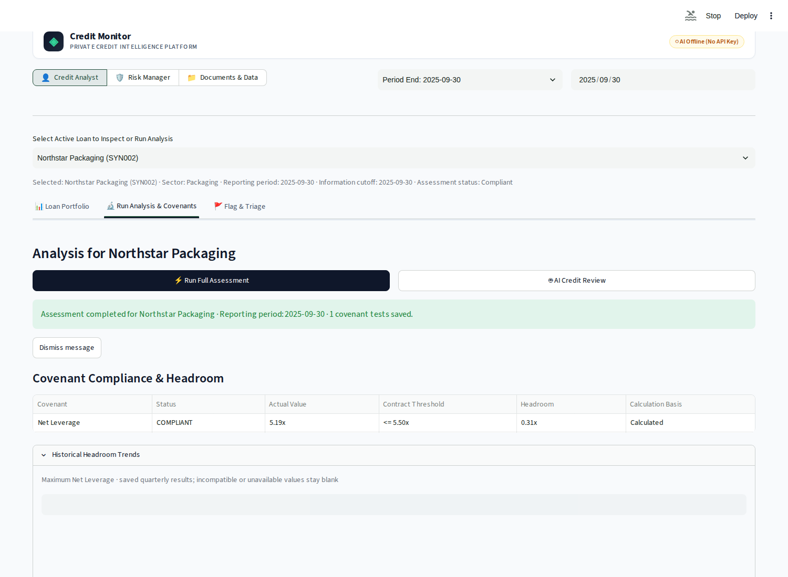
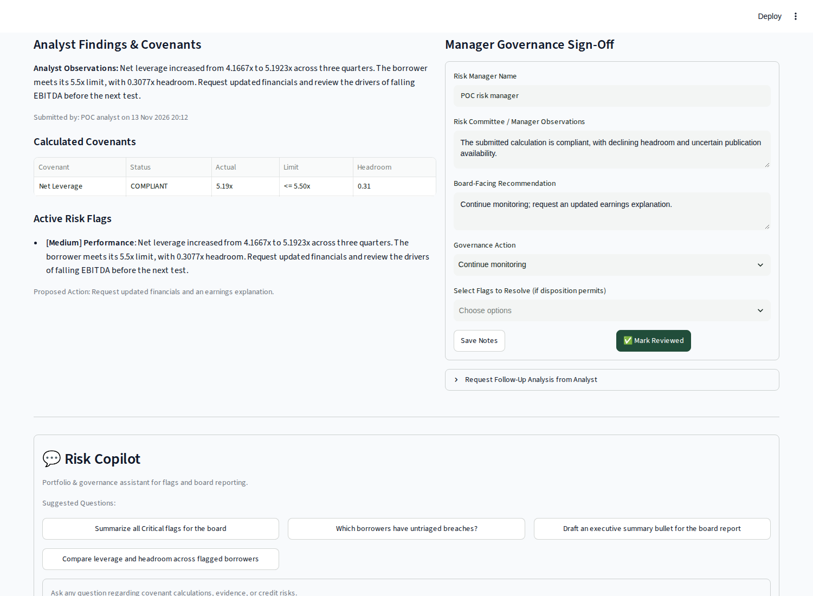

# Worked example: compliant, but with less room to spare

An analyst reviews fictional borrower **SYN002** at **30 September 2025**, using
the same date as the information cutoff. The question is whether the borrower
meets its leverage covenant and whether the trend deserves manager attention.

This is prepared synthetic financial data. It is not an assessment of a real SEC
issuer, and unknown publication dates prevent a claim of full point-in-time
reliability.

## 1. Establish the inputs and applicable term

The [financial CSV](../data/app/synthetic/synthetic_quarterly_financials.csv) supplies
debt, cash, and reported EBITDA. The
[terms CSV](../data/app/synthetic/synthetic_covenant_terms.csv) sets quarterly
maximum net leverage at **5.5x**, with eligible cash capped at **15**. SYN002 has
no eligible addbacks, so adjusted EBITDA equals reported EBITDA.

| Input | September 2025 | Effect |
| --- | ---: | --- |
| Total debt | 145 | Start of net-debt calculation |
| Cash | 10 | Below the 15 cash-netting cap |
| Reported EBITDA | 26 | Denominator, with no addbacks |
| Maximum net leverage | 5.5x | Covenant limit |

The legacy rows do not declare currency/scale metadata. The ratio uses the supplied
consistent units; do not relabel them as verified USD millions or infer a different
earnings period.

```text
Eligible cash  = min(10, 15) = 10
Net debt       = 145 − 10 = 135
Net leverage   = 135 / 26 = 5.1923076923x
Headroom       = 5.5 − 5.1923076923 = 0.3076923077x
Compliance     = 5.1923076923 ≤ 5.5 → compliant
```

Comparisons use unrounded values. Web V2 displays **5.19x**, **5.50x**, and **0.31x**.
Headroom is ratio points, not cash available to lend or a default probability.

## 2. Read the trend, not just the status

| Period | Net leverage | Headroom against 5.5x |
| --- | ---: | ---: |
| 31 March 2025 | 4.1667x | 1.3333x |
| 30 June 2025 | 4.6429x | 0.8571x |
| 30 September 2025 | 5.1923x | 0.3077x |

Debt rises while EBITDA falls. The borrower remains compliant, but its cushion is
shrinking. That supports a monitoring discussion; it does not establish payment
default, investment loss, or a complete lending recommendation.

## 3. Reproduce the analyst view

Run `make preview-v2`. Choose **Credit Analyst**, period **2025-09-30**, cutoff
**2025-09-30**, and the borrower whose label contains **SYN002**. Open **Run Analysis
& Covenants → Run Full Assessment**. Inspect the covenant table and historical trends.



Ask **“Explain the covenant headroom trend”** in **Analyst Assistant**. The captured
no-key fallback includes the actual saved result:

```text
Current Covenant Status & Headroom:
net_leverage: Status COMPLIANT, Actual: 5.19x, Threshold: <= 5.50x, Headroom: 0.31
```

This excerpt is from the rule-based saved-assessment response, not an LLM
generation or a semantic-quality result. Inspect the
[captured answer](assets/v2-fallback-answer.md) and [assistant screenshot](assets/v2-assistant.png).

With provider credentials, **AI Credit Review** runs the bullish and bearish roles,
then recommendation synthesis. Ask both perspectives to address the declining
cushion and missing broader credit context. The agents' arguments are advisory;
their benefit over a single reviewer has not been measured. Existing
[live captures](evaluation/results.md#agent-baseline-and-smoke) show actual tool and
model behavior separately from this offline demonstration.

## 4. Submit findings and record manager review

In **Flag & Triage**, add a **Performance** flag at **Medium** severity:

> Net leverage increased from 4.1667x to 5.1923x across three quarters. The borrower
> meets its 5.5x limit, with 0.3077x headroom. Request updated financials and review
> the drivers of falling EBITDA before the next test.

Record the same observation, save a draft, then **Submit to Risk Manager**.
The flag makes this compliant case visible in the manager's exception queue.
V2 automatically records validation checks during submission; that does not
establish that independent verification was performed.

Switch to **Risk Manager → Review & Sign-Off**, select SYN002, and inspect the
submission. Record a manager observation and board-facing recommendation such as
“Continue monitoring; request an updated earnings explanation.” **Mark Reviewed**
records the decision against the submitted case. These are demonstration notes,
not observed conclusions from an external credit professional.



Generate a draft in **Board Report Studio**, inspect the exception register, save
the summary and recommendation, and finalize the snapshot. See the
[complete workflow](guides/web-v2-workflow.md) for controls and limitations.

## 5. Keep the later outcome separate

The prepared December 2025 data gives leverage of **5.6x**, breaching the **5.5x**
limit by **0.1x**. That later outcome can be used to evaluate a September warning;
it must not be supplied as September evidence. The observed trend alone does not
prove the ML model predicted that event accurately.

## Separate example: retrieve a public filing

Notebook 02 and the document service use public SEC filings. For example, search
FMC for `maximum leverage` and inspect the returned filing IDs, quotations, and
dated threshold schedule. An existing portable
[FMC source fixture](../tests/fixtures/public_sec_snapshot/README.md) supports
inspection without downloading a new filing.

The [captured source excerpts](../tests/fixtures/public_sec_snapshot/fmc_source_excerpts.json)
identify `DOC_FMC_AMD3_2025` and `DOC_FMC_Q1_2025`, with source URLs, hashes, and
original locations. The quarterly disclosure supplies these **reported** ratios
for the four consecutive quarters ended 31 March 2025:

| Metric | Reported actual | Applicable limit | Disclosed comparison |
| --- | ---: | ---: | --- |
| Leverage | 4.77x | Maximum 5.25x | Below the maximum |
| Interest coverage | 3.84x | Minimum 3.00x | Above the minimum |

The analyst must preserve actual-versus-limit distinctions and link the limit
to the correct quarter. These are source-reported comparisons, not ratios
independently reconstructed from debt and earnings. The historical extraction
mixed these roles and borrowed an interest-coverage operator for leverage; the
fixture preserves that failure for inspection.

This demonstrates retrieval and extraction independently of SYN002. Do not bind
FMC to SYN002 or imply that an extracted clause automatically became the synthetic
calculation rule. Public-source extraction acceptance remains open; see
[recorded failures](evaluation/results.md#public-source-extraction).
